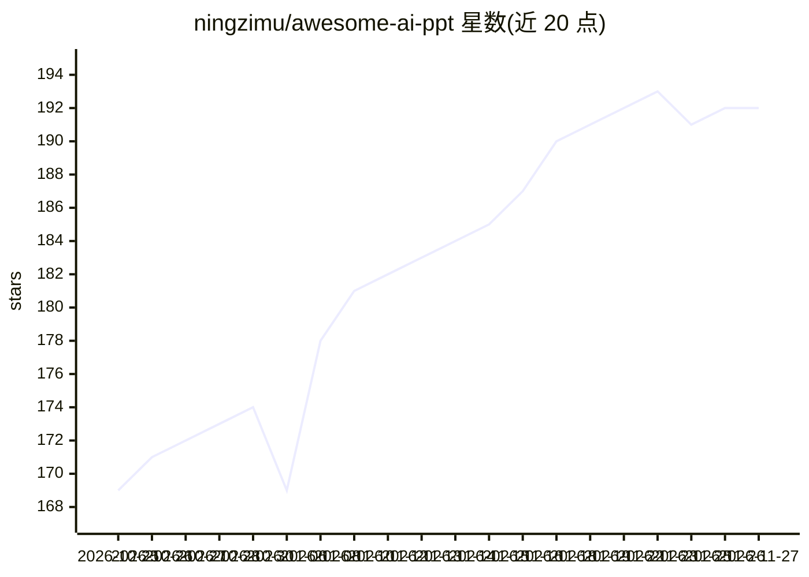

# ningzimu/awesome-ai-ppt

⭐ 192 · Python · NOASSERTION · 推送 2026-11-26 · [GitHub](https://github.com/ningzimu/awesome-ai-ppt) · [官网](https://ningzimu.github.io/awesome-ai-ppt/) · 个人维护 · 中文 README

**为 agent/开发者精选 AI PPT 生成与 PPTX 编辑工具的清单**

一个精选列表仓库，收录能帮助 agent 或开发者创建、编辑、转换或检查演示文稿的 GitHub 项目，按四类组织：HTML 风格 PPT、图片生成式 PPT、PPTX 库生成式方案、PPTX 库与自动化基础设施；每条含简介、可编辑性标注、是否带 Skill/MCP 及 Star 数。仓库自带 awesome-ai-ppt skill，可经 npx 安装，由 AI 结合清单做个性化推荐与贡献辅助，并提供文档网站。

## 筛选速览

| 维度 | 判定 | 备注 |
|---|---|---|
| AI 角色 | `ai-knowledge` | 知识聚合/清单类 |
| 许可风险 | `none` | NOASSERTION |
| 部署形态 | `library` | 以包/库形式分发 |
| 模型依赖 | — | README 未给出锁定关系 |
| 硬件要求 | — | 无带数字的原话,不猜 |
| 安装摩擦 | `low` | 无编译、无系统依赖或容器化 |
| 成熟度 | — | 结构信号不足 |

## 能力要点

- 按 HTML-first / 图片式 / PPTX 原生 / 基础设施四类组织条目
- 每条标注可编辑性与是否提供 Skill/MCP
- 提供 awesome-ai-ppt skill，支持 npx 安装并由 AI 个性化推荐工具
- 配套文档网站 ningzimu.github.io/awesome-ai-ppt

## 适用场景

- 为 agent 挑选合适的 AI PPT 生成工具
- 查找能把 HTML/图片/Markdown 转换为可编辑 PPTX 的方案
- 了解 PPTX 库与自动化基础设施生态

## 场景标签

`精选清单` · 领域:学习与行业

## 证据(README 行号)

> L9: 一个关于 AI PPT、PowerPoint 自动化、PPTX 编辑和幻灯片工作流工具的开源项目精选清单。
> L11: 这是一个精选列表，不是“所有相关链接大全”。本仓库重点收集能帮助 agent 或开发者创建、编辑、转换或检查演示文稿的 GitHub 仓库与技术项目。
> L17: 本仓库提供 `awesome-ai-ppt` skill。告诉 AI 你的场景、材料和偏好，它会结合这个清单帮你个性化推荐合适的 AI PPT 工具；也可以在你需要时辅助提交问题、准备 PR，一起贡献这个项目。

## 星数曲线

2026-10-25 169 → 2026-11-27 192（+23）

---
*卡片 v1 · prompt 1.4 · 生成 2026-11-26 · 置信度 mid · 依据 README sha `2ad63e66ec60` · [字段定义](../../DATASET.md)*
