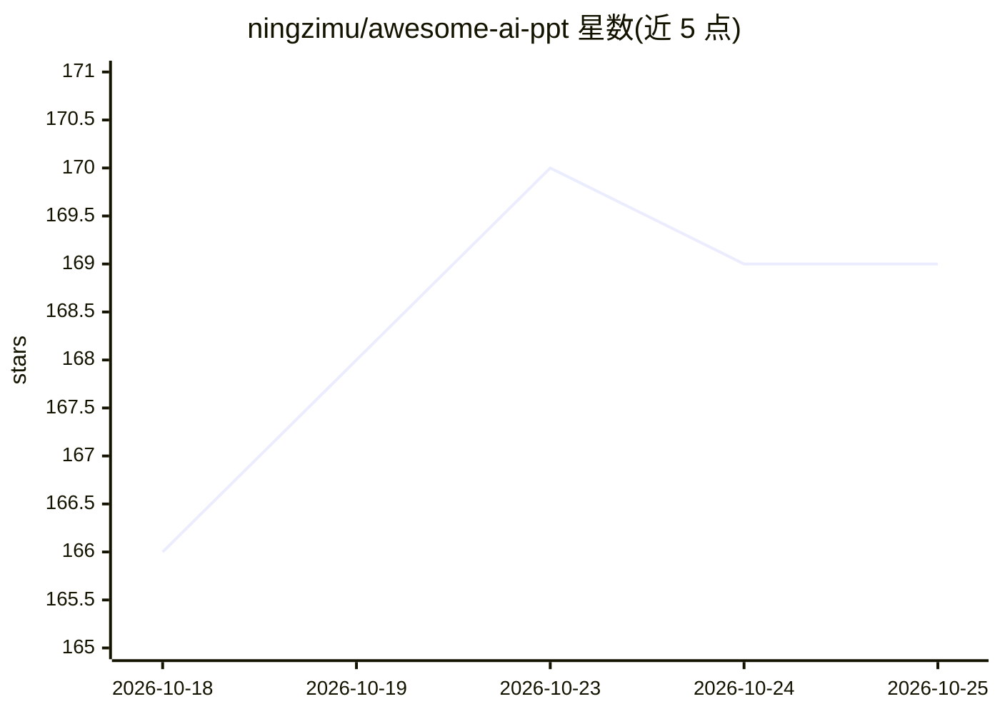

# ningzimu/awesome-ai-ppt

⭐ 169 · Python · NOASSERTION · 推送 2026-10-23 · [GitHub](https://github.com/ningzimu/awesome-ai-ppt) · [官网](https://ningzimu.github.io/awesome-ai-ppt/) · 个人维护 · 中文 README

**AI PPT 工具精选清单：收录演示文稿生成/编辑/转换项目**

一个 awesome 类精选清单，收录能帮助 agent 或开发者创建、编辑、转换、检查演示文稿的 GitHub 项目，按四类组织：HTML 风格 PPT 方案、图片生成式方案、PPTX 库生成式方案、PPTX 库与自动化基础设施。条目标注简介、标签、可编辑性、Skill/MCP 形态与 Star 数。另提供 awesome-ai-ppt skill，可让 AI 根据场景个性化推荐清单中的工具并辅助贡献 PR。声明为精选列表而非链接大全。

## 筛选速览

| 维度 | 判定 | 备注 |
|---|---|---|
| AI 角色 | `ai-knowledge` | 知识聚合/清单类 |
| 许可风险 | `none` | NOASSERTION |
| 部署形态 | `library` | 以包/库形式分发 |
| 模型依赖 | — | README 未给出锁定关系 |
| 硬件要求 | — | 无带数字的原话,不猜 |
| 安装摩擦 | `low` | 无编译、无系统依赖或容器化 |
| 成熟度 | — | 结构信号不足 |

## 能力要点

- 四大类组织：HTML-first、Image-first、PPTX 库生成式、底层库与自动化基础设施
- 每条目标注可编辑性、Skill/MCP 形态与 Star 数
- 提供 awesome-ai-ppt skill 供 agent 个性化推荐与辅助贡献
- 附 GitHub Pages 网站

## 适用场景

- 为 agent 或开发者查找合适的 AI PPT 生成/编辑工具
- 按可编辑性与接入形态（Skill/MCP/应用）筛选演示文稿项目
- 让 AI 结合清单为自己推荐最合适的 AI PPT 方案

## 场景标签

`精选清单` · 领域:学习与行业

## 证据(README 行号)

> L9: 一个关于 AI PPT、PowerPoint 自动化、PPTX 编辑和幻灯片工作流工具的开源项目精选清单。
> L11: 这是一个精选列表，不是“所有相关链接大全”。本仓库重点收集能帮助 agent 或开发者创建、编辑、转换或检查演示文稿的 GitHub 仓库与技术项目。

## 星数曲线

2026-10-18 166 → 2026-10-25 169（+3）

---
*卡片 v1 · prompt 1.4 · 生成 2026-10-22 · 置信度 mid · 依据 README sha `e5ac0050a236` · [字段定义](../../DATASET.md)*
