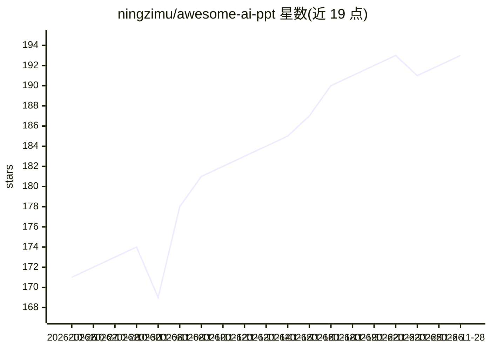

# ningzimu/awesome-ai-ppt

⭐ 193 · Python · NOASSERTION · 推送 2026-11-27 · [GitHub](https://github.com/ningzimu/awesome-ai-ppt) · [官网](https://ningzimu.github.io/awesome-ai-ppt/) · 个人维护 · 中文 README

**面向 agent 与开发者的 AI PPT 工具精选清单**

收录 AI PPT、PowerPoint 自动化、PPTX 编辑与幻灯片工作流相关 GitHub 项目的精选清单，按 HTML 风格、图片生成式、PPTX 库生成式及底层库/自动化基础设施四类组织，每条附简介、可编辑性、Skill/MCP 支持与 Star 数。面向 agent 或开发者，用于查找创建、编辑、转换或检查演示文稿的工具。仓库自带 awesome-ai-ppt skill，可通过 npx 安装后由 AI 依据用户场景个性化推荐清单内工具。

## 筛选速览

| 维度 | 判定 | 备注 |
|---|---|---|
| AI 角色 | `ai-knowledge` | 知识聚合/清单类 |
| 许可风险 | `none` | NOASSERTION |
| 部署形态 | `library` | 以包/库形式分发 |
| 模型依赖 | — | README 未给出锁定关系 |
| 硬件要求 | — | 无带数字的原话,不猜 |
| 安装摩擦 | `low` | 无编译、无系统依赖或容器化 |
| 成熟度 | — | 结构信号不足 |

## 能力要点

- 按 HTML 风格/图片生成式/PPTX 库生成式/基础设施四类组织条目
- 每条标注可编辑性、Skill 或 MCP 支持、Star 数
- 提供 awesome-ai-ppt skill，npx 一条命令安装给 codex 等 agent
- 附在线文档网站

## 适用场景

- 让 agent 根据我的材料推荐合适的 AI PPT 工具
- 查找能把 HTML 或图片重建为可编辑 PPTX 的方案
- 寻找操作 PPTX 的底层库与自动化基础设施

## 场景标签

`精选清单` · 领域:学习与行业

## 证据(README 行号)

> L9: 一个关于 AI PPT、PowerPoint 自动化、PPTX 编辑和幻灯片工作流工具的开源项目精选清单。
> L11: 这是一个精选列表，不是“所有相关链接大全”。本仓库重点收集能帮助 agent 或开发者创建、编辑、转换或检查演示文稿的 GitHub 仓库与技术项目。
> L17: 本仓库提供 `awesome-ai-ppt` skill。告诉 AI 你的场景、材料和偏好，它会结合这个清单帮你个性化推荐合适的 AI PPT 工具；也可以在你需要时辅助提交问题、准备 PR，一起贡献这个项目。

## 星数曲线

2026-10-26 171 → 2026-11-28 193（+22）

---
*卡片 v1 · prompt 1.4 · 生成 2026-11-27 · 置信度 mid · 依据 README sha `4d30f05d7e2c` · [字段定义](../../DATASET.md)*
