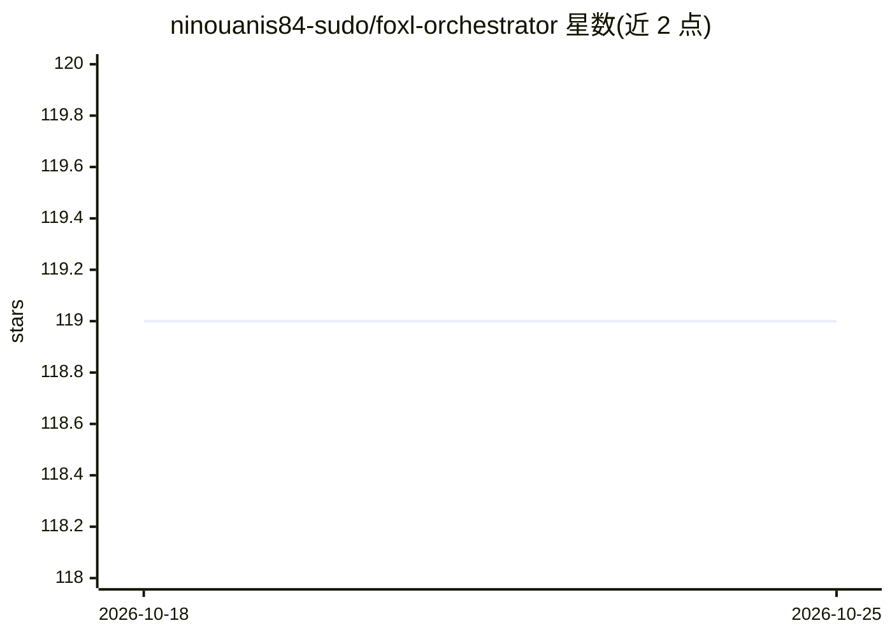

# ninouanis84-sudo/foxl-orchestrator

⭐ 119 · HTML · 推送 2026-10-25 · [GitHub](https://github.com/ninouanis84-sudo/foxl-orchestrator) · 个人维护

**面向个人用户的全天候 AI 代理助手，自动化日常任务**

Foxl 是一个个人 AI 代理项目，定位为 24/7 运行的数字助手：通过事件驱动模型处理新邮件、日历更新、笔记等触发事项，核心引擎负责意图解析、上下文存储与动作分发。支持多语言处理模块、跨设备的响应式 Web UI、RESTful API 与 webhook 集成桥接。README 给出的上手方式是浏览 config、modules、docs 目录进行配置与扩展，未提供具体的安装命令或构建产物。采用 MIT 许可证。主题标签提及 Electron、Chrome 扩展与 Claude 相关模型，但 README 正文未给出对应细节。

## 筛选速览

| 维度 | 判定 | 备注 |
|---|---|---|
| AI 角色 | `ai-native` | 本体是模型或模型工具 |
| 许可风险 | `none` | — |
| 部署形态 | `None` |  |
| 模型依赖 | — | README 未给出锁定关系 |
| 硬件要求 | — | 无带数字的原话,不猜 |
| 安装摩擦 | `low` | 无编译、无系统依赖或容器化 |
| 成熟度 | — | 结构信号不足 |

## 能力要点

- 事件驱动核心引擎：意图解析、上下文存储、动作分发
- 多语言处理模块（启动时动态加载）与响应式多设备 UI
- RESTful API 与 webhook 的第三方集成桥接
- MIT 许可证

## 适用场景

- 自动分类邮件、管理日程与智能提醒
- 小团队 24/7 监控客户咨询并生成日报
- 科研学习中汇总文章与跟踪引文

## 场景标签

`AI 助手` · 领域:对话与助手

## 证据(README 行号)

> L3: # Foxl 🦊 – Your 24/7 Personal AI Agent
> L61: - **Core Engine**: Handles intent parsing, context storage, and action dispatch.

## 星数曲线

2026-10-18 119 → 2026-10-25 119（+0）

---
*卡片 v1 · prompt 1.4 · 生成 2026-10-23 · 置信度 mid · 依据 README sha `a80b5300c430` · [字段定义](../../DATASET.md)*
