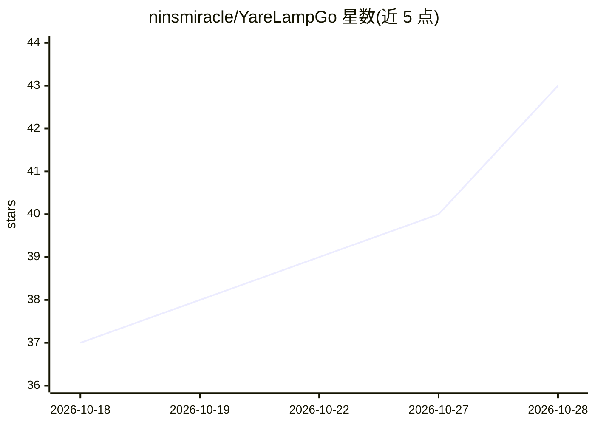

# ninsmiracle/YareLampGo

⭐ 43 · Python · GPL-3.0 · 推送 2026-10-26 · [GitHub](https://github.com/ninsmiracle/YareLampGo) · 个人维护 · 中文 README

**开源桌面 AI 机械臂台灯：可语音对话、看、动、自建表情**

面向 DIY 与非技术用户的开源 5 自由度机械臂台灯项目，集成电机、屏幕、RGB LED、摄像头、麦克风与大模型，提供 Web 控制台、语音识别（'Hi,小星'唤醒）与语音对话。真实动作均经过 MotionRuntime 与 SafetyKernel 安全检查层。配套两个 Codex skill：$lampgo-setup 引导安装、$lampgo-control 通过安全 MCP 控制硬件。支持无硬件的 --no-hw 软件体验模式。V2.0 开源 STEP 总成、接线表与固件仓库，固件烧录以独立 esp32 仓库为准。GPL-3.0-only。

## 筛选速览

| 维度 | 判定 | 备注 |
|---|---|---|
| AI 角色 | `ai-native` | 本体是模型或模型工具 |
| 许可风险 | `viral` | GPL-3.0 |
| 部署形态 | `None` |  |
| 模型依赖 | — | README 未给出锁定关系 |
| 硬件要求 | — | 无带数字的原话,不猜 |
| 安装摩擦 | `low` | 无编译、无系统依赖或容器化 |
| 成熟度 | — | 结构信号不足 |

## 能力要点

- 5 自由度机械臂 + 摄像头 + 语音，真实动作经 MotionRuntime/SafetyKernel 安全检查
- 两个 Codex skill：安装引导与通过安全 MCP 控制 '身体'
- 无硬件也能用 --no-hw 运行 Web 控制台
- 动作/表情/灯光可录制并组合成自定义 skill

## 适用场景

- DIY 一台能听、能看、会动的桌面 AI 台灯
- 不写代码，在浏览器里聊天、控制动作、画 LED 表情
- 让 Codex 代为装机、排查问题和执行台灯上的真实任务
- 通过 CLI、HTTP/WebSocket API 接入其他 Agent

## 场景标签

`语音 Agent` · 领域:对话与助手

## 证据(README 行号)

> L5: > 一盏能听、能看、会动、还会用表情回应你的开源桌面 AI 机械臂台灯。
> L16: YareLampGo 把电机、屏幕、RGB LED、摄像头、麦克风和大模型装进一盏台灯里。你可以在网页上控制它，也可以直接对它说话，或者让 Codex 帮你装机、排查问题和完成复杂任务。
> L22: - **能听会说。** 支持语音识别、`Hi,小星` 唤醒、语音播报和实时语音对话。

## 星数曲线

2026-10-18 37 → 2026-10-28 43（+6）

---
*卡片 v1 · prompt 1.4 · 生成 2026-10-25 · 置信度 high · 依据 README sha `294db882730d` · [字段定义](../../DATASET.md)*
