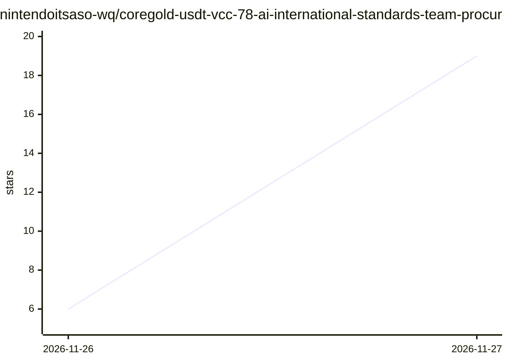

# nintendoitsaso-wq/coregold-usdt-vcc-78-ai-international-standards-team-procurement-guide

⭐ 19 · 推送 2026-11-25 · [GitHub](https://github.com/nintendoitsaso-wq/coregold-usdt-vcc-78-ai-international-standards-team-procurement-guide) · [官网](https://app.coregold.io/signup?invite_code=ADvlj9b) · 个人维护 · 中文 README

**面向出海团队的海外虚拟卡开卡与采购管理操作指南**

以 AI 国际标准新闻为引子的操作指南类内容，主体是 CoreGold 虚拟卡平台的注册、充值与用卡教程：覆盖个人/团队计划开卡、USDT（TRC20）充值流程、按部门独立开卡、北美 AVS 账单信息登记，以及将虚拟卡绑定 Apple Pay/Google Pay 并获取验证码的步骤。面向出海技术公司、跨境服务商的采购与报销规范化场景。文末含带邀请码的注册链接，内容为商业推广性质，README 未提供开源代码。

## 筛选速览

| 维度 | 判定 | 备注 |
|---|---|---|
| AI 角色 | `ai-knowledge` | 知识聚合/清单类 |
| 许可风险 | `none` | — |
| 部署形态 | `None` |  |
| 模型依赖 | — | README 未给出锁定关系 |
| 硬件要求 | — | 无带数字的原话,不猜 |
| 安装摩擦 | `low` | 无编译、无系统依赖或容器化 |
| 成熟度 | — | 结构信号不足 |

## 能力要点

- 按部门/产品线独立开卡并在后台统一查看余额与状态
- USDT（TRC20）网络充值母钱包并按预算划拨单卡
- 登记北美 AVS 标准账单档案以完成商户端绑卡
- 支持绑定 Apple Pay / Google Pay 并在后台获取邮箱验证码

## 适用场景

- 为出海团队的海外 SaaS 订阅和云账单集中开卡管理
- 用 USDT 给跨境团队统一充值并分卡报销
- 注册海外 AI 工具或应用商店账号时完成支付卡绑定验证

## 场景标签

`教程课程` · 领域:学习与行业

## 证据(README 行号)

> L2: 11 月 24 日至 25 日最新消息显示中国已牵头制定 78 项人工智能国际标准，全球 AI 产业规范化提速——聊聊出海技术公司与跨境团队怎么把海外 SaaS 采购、云账单和分卡报销做得规范透明。
> L9: ### 🔍 实战干货：规范化管理团队海外用卡的 4 个实操标准
> L22: ### 🧭 CoreGold 极简开卡与绑定教程（一看就会）

## 星数曲线

2026-11-26 6 → 2026-11-27 19（+13）

---
*卡片 v1 · prompt 1.4 · 生成 2026-11-26 · 置信度 mid · 依据 README sha `562c5ec94db6` · [字段定义](../../DATASET.md)*
