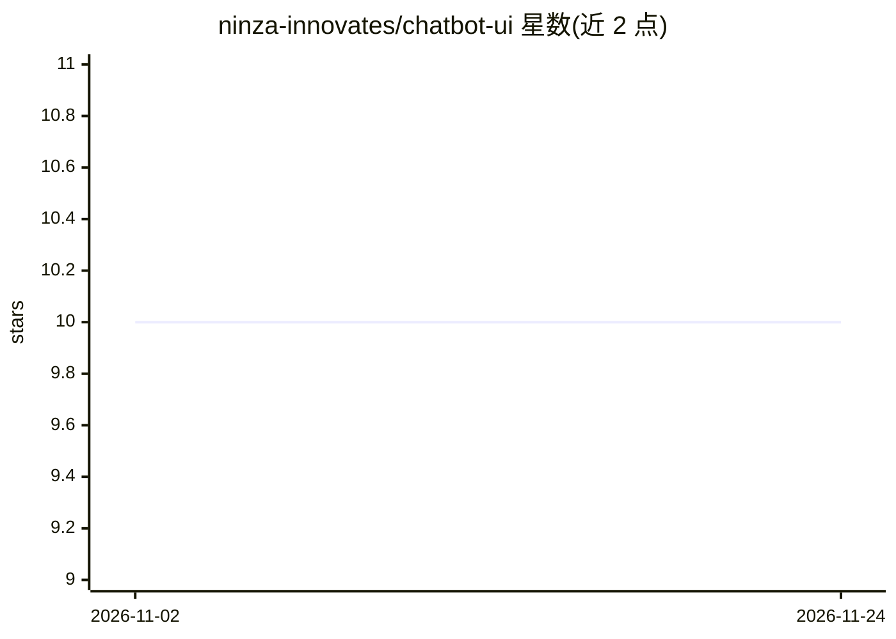

# ninza-innovates/chatbot-ui

⭐ 10 · TypeScript · MIT · 推送 2026-11-02 · [GitHub](https://github.com/ninza-innovates/chatbot-ui) · 个人维护

**开源 AI 聊天应用：自托管的对话界面**

基于 Next.js 与 Supabase 的开源 AI 聊天应用，本仓库为 mckaywrigley/chatbot-ui 的 fork（上游 MIT 许可）。应用支持本地运行与云端部署两条路径：本地用 Docker 运行 Supabase 存储数据，npm 运行于 localhost:3000；托管版通过 Supabase 云数据库与 Vercel 部署前端，含 Email 认证配置与数据库迁移流程。支持本地模型（通过环境变量 NEXT_PUBLIC_OLLAMA_URL 配置）与 OpenAI/Azure API key 接入。

## 筛选速览

| 维度 | 判定 | 备注 |
|---|---|---|
| AI 角色 | `ai-native` | 本体是模型或模型工具 |
| 许可风险 | `permissive` | MIT |
| 部署形态 | `library` | 以包/库形式分发 |
| 模型依赖 | local-ok | 支持本地模型 |
| 硬件要求 | — | 无带数字的原话,不猜 |
| 安装摩擦 | `low` | 无编译、无系统依赖或容器化 |
| 成熟度 | — | 结构信号不足 |

## 能力要点

- 本地 Quickstart：git clone + npm install + Docker 运行 Supabase
- 托管部署：Supabase 云数据库 + Vercel 前端
- 可选 Ollama 本地模型（NEXT_PUBLIC_OLLAMA_URL）
- 1.0 旧版代码保留于 legacy 分支，提供 npm run update 更新机制

## 适用场景

- 自托管一个个人 AI 聊天界面
- 用本地 Ollama 模型搭配聊天界面使用
- 通过 Supabase + Vercel 部署云端聊天实例

## 场景标签

`聊天机器人` · 领域:对话与助手

## 证据(README 行号)

> L5: The open-source AI chat app for everyone.
> L169: Your local instance of Chatbot UI should now be running at http://localhost:3000. Be sure to use a compatible node

## 星数曲线

2026-11-02 10 → 2026-11-24 10（+0）

---
*卡片 v1 · prompt 1.4 · 生成 2026-11-19 · 置信度 high · 依据 README sha `a527cde8fa7f` · [字段定义](../../DATASET.md)*
