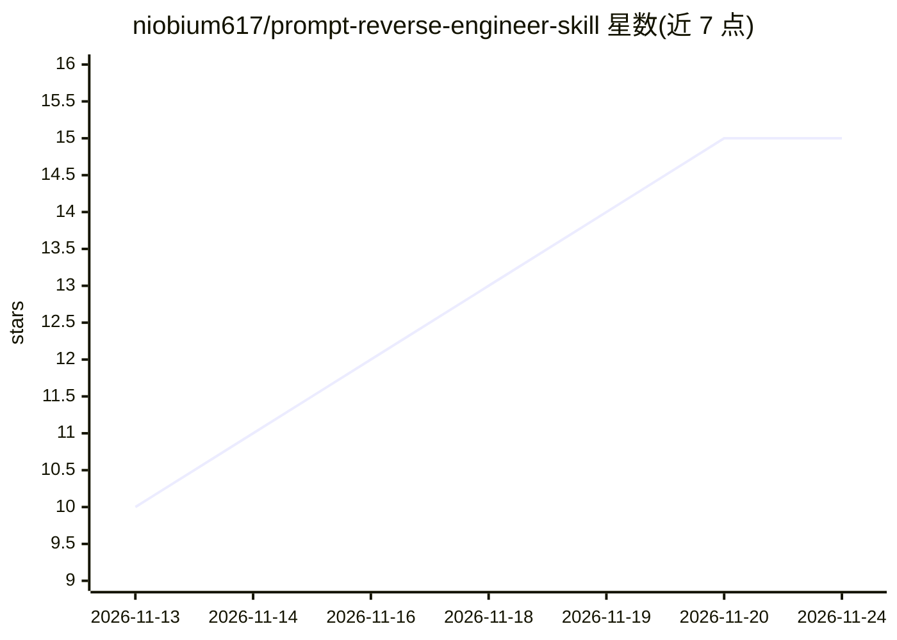

# niobium617/prompt-reverse-engineer-skill

⭐ 15 · Python · MIT · 推送 2026-11-21 · [GitHub](https://github.com/niobium617/prompt-reverse-engineer-skill) · 个人维护 · 中文 README

**把作品逆向拆解为可复用 Prompt 的多模态 Agent 技能**

以插件形态安装到 Claude Code、Cursor、Codex、DeepSeek Harness、豆包五类 Agent 平台的技能包：输入文本、图片、视频、剧本或 ComfyUI 工作流 JSON，脚本层用 Python 标准库与 opencv/pillow/numpy 提取确定性信号（字数统计、主色、镜头切分、节点解析），语义判断交给宿主 Agent，最终按十六种目标模型语法输出适配的 Prompt 并附百分制六维评分。脚本不可用时提供纯指令降级模式；ComfyUI 工作流仅只读解析，不生成可导入文件，不调用平台 API。

## 筛选速览

| 维度 | 判定 | 备注 |
|---|---|---|
| AI 角色 | `ai-native` | 本体是模型或模型工具 |
| 许可风险 | `permissive` | MIT |
| 部署形态 | `desktop` | 安装包/桌面程序 |
| 模型依赖 | locked-api |  |
| 硬件要求 | — | 无带数字的原话,不猜 |
| 安装摩擦 | `medium` | 含编译或系统依赖之一 |
| 成熟度 | — | 结构信号不足 |

## 能力要点

- 五模态输入（文本/图片/视频/剧本/ComfyUI 工作流）拆解为可复用 Prompt
- 十六种目标模型格式适配（Midjourney、SD 3.5、FLUX.2、Sora 2、Seedance 等）
- 百分制六维加权评分并附优化建议
- 脚本层与 Agent 分工：脚本缺失时降级为纯指令模式仍可运行

## 适用场景

- 把爆款文案逆向成可复用的写作 Prompt
- 从 AI 图片还原正向/负向 Prompt 与摄影参数
- 把实拍视频逐镜反推为分镜脚本与视频生成 Prompt
- 把剧本按场景拆成图片和视频提示词

## 场景标签

`提示工程` · 领域:Agent 开发

## 证据(README 行号)

> L5: > 支持 **Claude Code / Cursor / Codex / DeepSeek Harness / 豆包** 五大平台 · **文本 / 图片 / 视频 / 剧本小说 / ComfyUI 工作流** 多模态输入 · *
> L9: 纯插件形态：无前端、无后端、无数据库、无 API key、无状态、幂等、零新增依赖（脚本仅用 Python 标准库 + opencv/pillow/numpy）。
> L95: > 纯指令降级模式（豆包粘贴版）无任何依赖。安装依赖：`pip install opencv-python pillow numpy`（URL 下载用标准库 `urllib`，无需额外包）

## 星数曲线

2026-11-13 10 → 2026-11-24 15（+5）

---
*卡片 v1 · prompt 1.4 · 生成 2026-11-18 · 置信度 low · 依据 README sha `853124224d92` · [字段定义](../../DATASET.md)*
