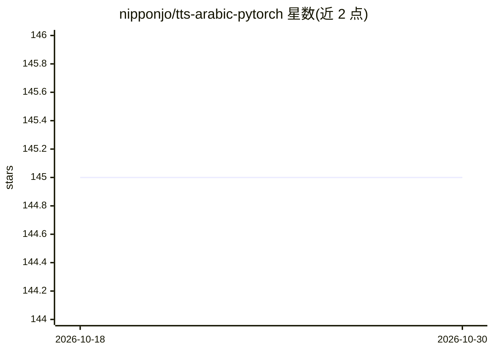

# nipponjo/tts-arabic-pytorch

⭐ 145 · Jupyter Notebook · 推送 2025-12-13 · [GitHub](https://github.com/nipponjo/tts-arabic-pytorch) · 个人维护

**阿拉伯语 TTS 模型库：Tacotron2/FastPitch 文本转语音**

基于 PyTorch 的阿拉伯语文本转语音模型仓库，提供在 Nawar Halabi 阿拉伯语语音语料上训练的 Tacotron2 与 FastPitch 模型，内置 HiFi-GAN 声码器实现端到端推理，并附 Shakkala/Shakkelha 去音标化文本自动元音化处理。支持 mse 与对抗损失两种权重、进行中的多说话人 FastPitch 模型、Buckwalter 转写输入、批量合成、CLI 推理脚本与 FastAPI 演示 Web 应用，也可用脚本自行训练。面向语音合成研究与应用开发者。多说话人数据部分由 XTTS-v2 合成生成。

## 筛选速览

| 维度 | 判定 | 备注 |
|---|---|---|
| AI 角色 | `ai-native` | 本体是模型或模型工具 |
| 许可风险 | `none` | — |
| 部署形态 | `library` | 以包/库形式分发 |
| 模型依赖 | — | README 未给出锁定关系 |
| 硬件要求 | — | 无带数字的原话,不猜 |
| 安装摩擦 | `medium` | 含编译或系统依赖之一 |
| 成熟度 | — | 结构信号不足 |

## 能力要点

- Tacotron2/FastPitch + HiFi-GAN 端到端阿拉伯语 TTS 推理
- 集成 Shakkala/Shakkelha 未元音化文本自动元音化
- 支持 Buckwalter 转写输入与批量合成
- 提供训练脚本、测试脚本与 FastAPI 演示 Web 应用

## 适用场景

- 合成带或不带元音符号的阿拉伯语语音
- 作为阿拉伯语 TTS 研究基线进行复现与训练
- 通过 FastAPI Web 应用演示或调用语音合成

## 场景标签

`语音合成` · 领域:内容生成

## 证据(README 行号)

> L8: TTS models (Tacotron2, FastPitch), trained on Nawar Halabi's Arabic Speech Corpus, including the HiFi-GAN vocoder fo
> L70: The `Tacotron2`/`FastPitch` from `models.tacotron2`/`models.fastpitch` are wrappers that simplify text-to-mel infer

## 星数曲线

2026-10-18 145 → 2026-10-30 145（+0）

---
*卡片 v1 · prompt 1.4 · 生成 2026-10-22 · 置信度 mid · 依据 README sha `e60b989f9133` · [字段定义](../../DATASET.md)*
