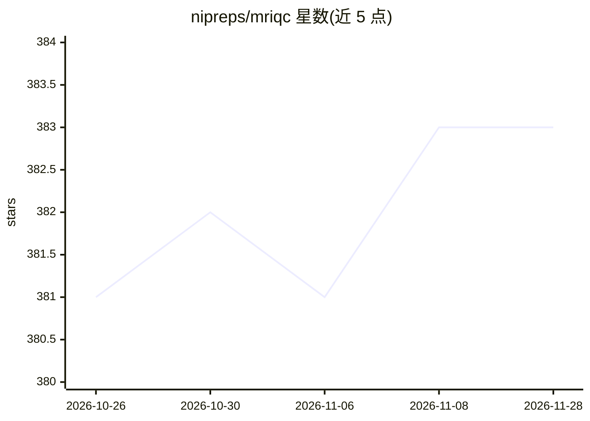

# nipreps/mriqc

⭐ 383 · Python · Apache-2.0 · 推送 2026-11-27 · [GitHub](https://github.com/nipreps/mriqc) · [官网](http://mriqc.readthedocs.io) · 组织维护

**为科研人员自动提取脑 MRI 影像质量指标并生成质控报告**

MRIQC 从结构像（T1w/T2w/FLAIR）、功能像和扩散 MRI 数据中提取无参考图像质量指标（IQMs），输出用于质量评估的可视化报告。基于 nipype 工作流集成 ANTs、AFNI 等第三方工具，遵循 BIDS 数据格式与 BIDS-App 标准，采用最小化预处理原则在原始或最小处理数据上估计指标。衍生自 PCP 质量评估协议，以 Apache 2.0 许可发布，由 NiPreps 社区维护。

## 筛选速览

| 维度 | 判定 | 备注 |
|---|---|---|
| AI 角色 | `ai-native` | 本体是模型或模型工具 |
| 许可风险 | `permissive` | Apache-2.0 |
| 部署形态 | `self-host` | docker 或自建部署 |
| 模型依赖 | — | README 未给出锁定关系 |
| 硬件要求 | — | 无带数字的原话,不猜 |
| 安装摩擦 | `low` | 无编译、无系统依赖或容器化 |
| 成熟度 | — | 结构信号不足 |

## 能力要点

- 提取结构、功能与扩散 MRI 的无参考图像质量指标（IQMs）
- 基于 nipype 工作流集成 ANTs 与 AFNI 工具箱
- 遵循 BIDS 与 BIDS-App 标准
- 提供可视化质量报告与 Docker 开发构建

## 适用场景

- 对脑 MRI 数据集做批量质量评估
- 研究前筛查采集质量不合格的扫描数据
- 多站点研究中比较不同采集参数的影像质量

## 场景标签

`科研工具` · 领域:学习与行业

## 证据(README 行号)

> L5: MRIQC extracts no-reference IQMs (image quality metrics) from
> L35:  *MRIQC: Advancing the Automatic Prediction of Image Quality in MRI from Unseen Sites*;

## 星数曲线

2026-10-26 381 → 2026-11-28 383（+2）

---
*卡片 v1 · prompt 1.4 · 生成 2026-11-25 · 置信度 high · 依据 README sha `fe8fde7bb901` · [字段定义](../../DATASET.md)*
