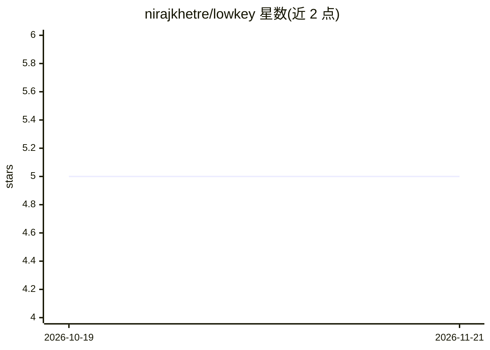

# nirajkhetre/lowkey

⭐ 5 · Python · MIT · 推送 2026-10-21 · [GitHub](https://github.com/nirajkhetre/lowkey) · 个人维护

**面向按小时计费者的本地隐私时间追踪岛，自动生成工时表**

以屏幕边缘 Dynamic Island 形式呈现的计时工具：读取窗口标题，交由本机 GPU 上的开放权重模型（经 Ollama 运行）将工作片段整理为可开票的工时条目，网络仅限 localhost。功能含客户切换生物形象、分心提醒、会话审核、按客户费率计费与发票生成；提供演示周模式（不追踪）与漂移学习修正机制。需要 Python 3.10+，支持 Windows 与 macOS，macOS 需授予辅助功能权限以读取窗口标题。

## 筛选速览

| 维度 | 判定 | 备注 |
|---|---|---|
| AI 角色 | `ai-native` | 本体是模型或模型工具 |
| 许可风险 | `permissive` | MIT |
| 部署形态 | `library` | 以包/库形式分发 |
| 模型依赖 | local-ok | 支持本地模型 |
| 硬件要求 | — | 无带数字的原话,不猜 |
| 安装摩擦 | `low` | 无编译、无系统依赖或容器化 |
| 成熟度 | — | 结构信号不足 |

## 能力要点

- 本地模型生成工时条目，数据不出本机（仅 localhost）
- 屏幕边缘小岛 UI：当前客户计时、今日收入、待审核会话
- 基于窗口标题与客户提示词的漂移检测与低频提醒
- 用户修正会话归属后模型学习新提示词，可撤销

## 适用场景

- 自由职业者按客户自动整理工时表并生成发票
- 多客户切换频繁、不想手动开关计时器的场景
- 屏幕活动含敏感信息、需完全本地化追踪的场景

## 场景标签

`工作流自动化` · 领域:效率与自动化

## 证据(README 行号)

> L8:  It watches what you work on, lets an open model running on your own GPU turn it into invoice-ready lines,
> L14:  Model: Gemma 4 via Ollama
> L31: **lowkey** does the watching *on your laptop*, with an open-weight model you run yourself. Nothing to sign up for, 

## 星数曲线

2026-10-19 5 → 2026-11-21 5（+0）

---
*卡片 v1 · prompt 1.4 · 生成 2026-11-21 · 置信度 high · 依据 README sha `d564bb5da23b` · [字段定义](../../DATASET.md)*
