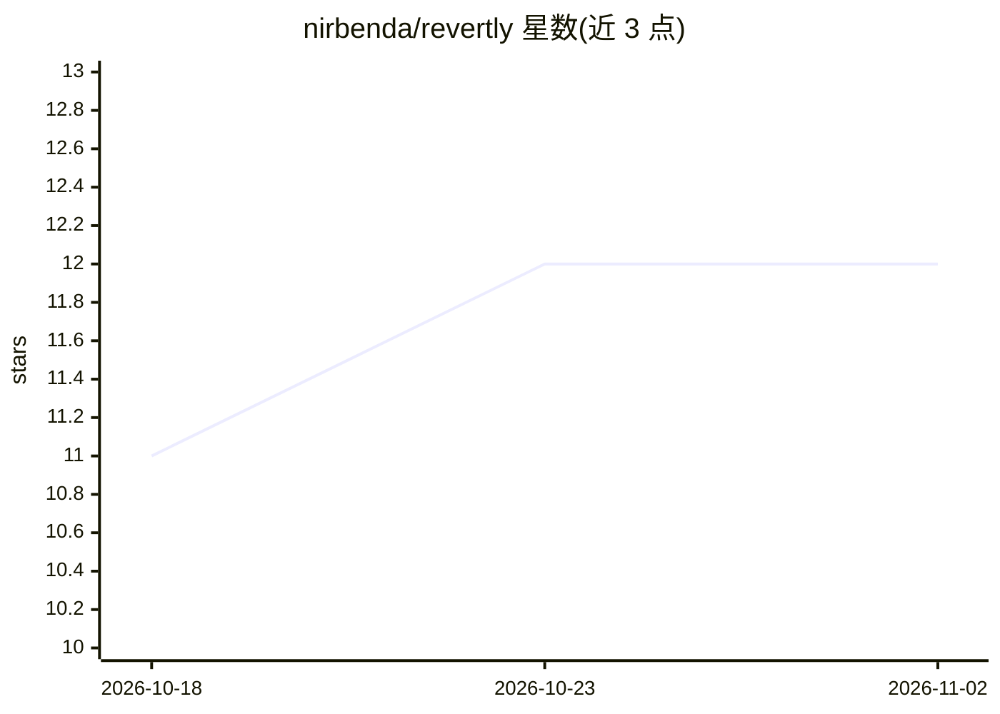

# nirbenda/revertly

⭐ 12 · Python · MIT · 推送 2026-08-16 · [GitHub](https://github.com/nirbenda/revertly) · 个人维护

**本地离线的 AI 编码代理安全网：记录并撤销文件改动、告警敏感读取**

面向使用 Claude Code、Codex、Cursor CLI 等 AI 编码代理的开发者的本地安全工具。它以 shim 方式包裹代理命令，在代理启动前对项目做 copy-on-write 预镜像快照（APFS clone / Btrfs-XFS reflink），将每次文件创建/编辑/删除/重命名写入哈希链式日志，支持回退单个文件、整个会话乃至一次完整的 rm -rf；同时以 tripwire 监控敏感路径（~/.ssh、.env、shell rc、LaunchAgents），触发即弹桌面通知，可选阻断。零第三方依赖，macOS APFS 全支持，Linux 实验性；自称处于早期 Phase 1，防篡改仅为可审计而非不可篡改，不替代常规备份。

## 筛选速览

| 维度 | 判定 | 备注 |
|---|---|---|
| AI 角色 | `ai-ecosystem` | LLM/agent 周边工具 |
| 许可风险 | `permissive` | MIT |
| 部署形态 | `None` |  |
| 模型依赖 | — | README 未给出锁定关系 |
| 硬件要求 | — | 无带数字的原话,不猜 |
| 安装摩擦 | `low` | 无编译、无系统依赖或容器化 |
| 成熟度 | `idea` | |

## 能力要点

- 代理运行前创建 copy-on-write 预镜像，支持文件/会话/整段 rm -rf 级回退
- 哈希链式只追加日志记录每个文件事件，verify 可审计篡改
- tripwire 监控敏感路径与 curl|sh、持久化伎俩，实时桌面告警，可选阻断
- 零第三方依赖，仅需 python3；install.sh 自动检测并绑定 PATH 上的代理 CLI

## 适用场景

- 让 AI 编码代理全速运行的同时保留撤销按钮，出事可一键回退
- 代理误删文件或读取 .env 等敏感路径时即时收到告警
- 事后审计某次代理会话到底改动了哪些文件

## 场景标签

`网络安全` · 领域:学习与行业

## 证据(README 行号)

> L12: Run Claude Code · Codex · Cursor exactly as you always do. revertly sits underneath —
> L141: - **Agents:** `install` **detects the agent CLIs on your PATH and binds the
> L143:  (`revertly agents` to list, `revertly bind <cmd>` for any other). Every bound

## 星数曲线

2026-10-18 11 → 2026-11-02 12（+1）

---
*卡片 v1 · prompt 1.4 · 生成 2026-11-01 · 置信度 high · 依据 README sha `01bdf0d96747` · [字段定义](../../DATASET.md)*
