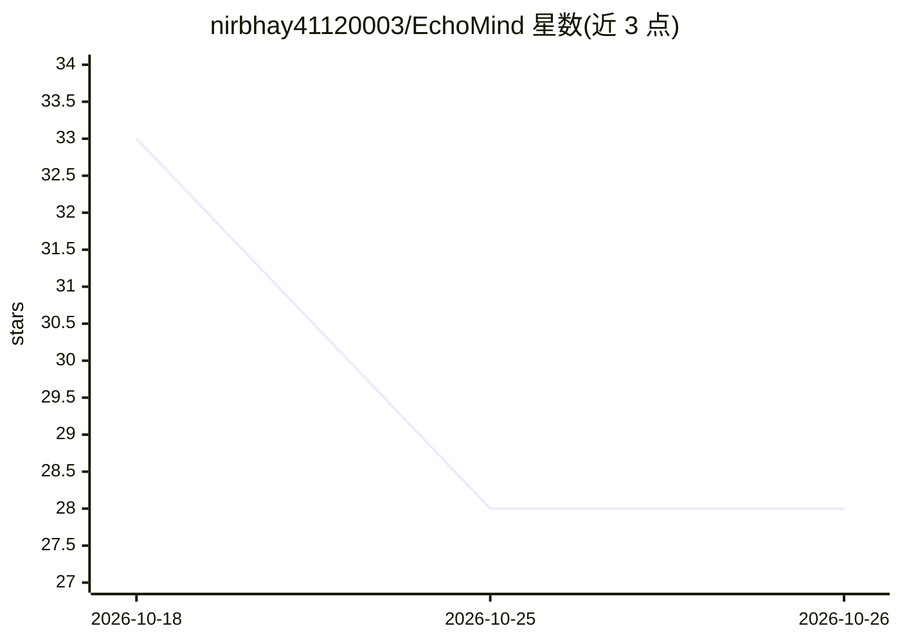

# nirbhay41120003/EchoMind

⭐ 28 · Python · MIT · 推送 2026-09-17 · [GitHub](https://github.com/nirbhay41120003/EchoMind) · [官网](https://echomemory-ui-demo.vercel.app/) · 个人维护

**本地优先的语音记忆助手：转写语音并可检索对话问答**

面向有听力困难者及易遗忘对话内容的用户的本地优先语音记忆助手：在浏览器中点击开始采集，本地 ASR 模型近实时转写语音，转写片段经本地嵌入存入 SQLite 并带时间戳，用户可用自然语言提问，由本地 GGUF 聊天模型基于检索到的转写内容生成有依据的回答，并提供每日摘要。默认全部在本机运行，无需云端；Sarvam 云语音为可选且需自备 key。支持 Python 3.12–3.14/macOS 与 Docker 两种运行方式，模型经应用内面板显式下载，无后台静默下载。限制：要求 macOS 与至少 4 GB 内存，Apple Silicon 上 llama-cpp-python 可能需本地编译。

## 筛选速览

| 维度 | 判定 | 备注 |
|---|---|---|
| AI 角色 | `ai-native` | 本体是模型或模型工具 |
| 许可风险 | `permissive` | MIT |
| 部署形态 | `self-host` | docker 或自建部署 |
| 模型依赖 | local-ok | 支持本地模型 |
| 硬件要求 | — | 无带数字的原话,不猜 |
| 安装摩擦 | `low` | 无编译、无系统依赖或容器化 |
| 成熟度 | — | 结构信号不足 |

## 能力要点

- 本地 ASR 近实时转写，浏览器内直接显示转写文本
- SQLite + 本地向量检索的长期记忆存储，可溯源时间戳
- 基于检索转写内容的本地 GGUF RAG 问答与每日摘要
- 默认全程本地运行，模型仅在应用内面板显式下载

## 适用场景

- 为听力困难者留存并检索日常对话记录
- 事后查找通话、会议或闲聊中提到的名字、计划等细节
- 在不上传录音的前提下用 AI 助手管理个人语音记忆

## 场景标签

`语音识别` `RAG` `Agent 记忆` `AI 助手` · 领域:Agent 开发

## 证据(README 行号)

> L24: a local-first voice memory assistant: it listens when you tell it to,
> L64: 2. **Transcribe** — a local ASR model converts speech to text in
> L70:  retrieves the relevant transcript chunks and answers using a local

## 星数曲线

2026-10-18 33 → 2026-10-26 28（-5）

---
*卡片 v1 · prompt 1.4 · 生成 2026-10-26 · 置信度 high · 依据 README sha `ac44b9268c7a` · [字段定义](../../DATASET.md)*
