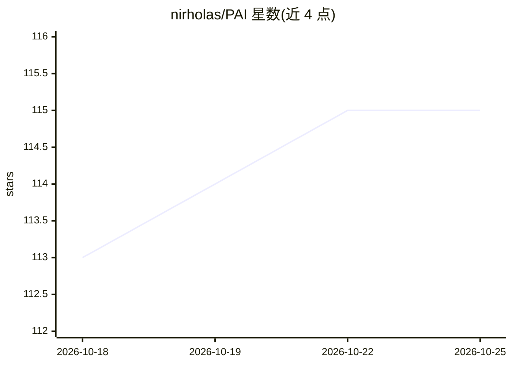

# nirholas/PAI

⭐ 115 · Shell · NOASSERTION · 推送 2026-10-24 · [GitHub](https://github.com/nirholas/PAI) · [官网](https://pai.direct) · 个人维护

**可启动 U 盘上的隐私优先本地 AI 工作站操作系统**

基于 Debian 12 live-build 构建的可启动 U 盘操作系统：整机载入 RAM 运行，通过 Ollama 在本机 CPU 上运行 GGUF 兼容模型（Llama 3.1、Mistral、Phi-3、Qwen 等），配 localhost 网页 Chat UI；同时提供 Sway 桌面、Firefox ESR、Tor/MAC 伪装/UFW 等隐私加固及加密货币钱包。主机硬盘从不挂载，关机即清空内存。限制：仅 CPU 推理（5-20 tokens/sec），官方托管下载暂时离线，当前主路径为 Docker 从源码构建 ISO 后刻录 U 盘。

## 筛选速览

| 维度 | 判定 | 备注 |
|---|---|---|
| AI 角色 | `ai-native` | 本体是模型或模型工具 |
| 许可风险 | `none` | NOASSERTION |
| 部署形态 | `self-host` | docker 或自建部署 |
| 模型依赖 | local-ok | 支持本地模型 |
| 硬件要求 | `cpu-ok` | |
| 安装摩擦 | `low` | 无编译、无系统依赖或容器化 |
| 成熟度 | — | 结构信号不足 |

## 能力要点

- 整系统在 RAM 中运行，关机清空内存，不触碰主机硬盘
- Ollama 本地推理，绑定 127.0.0.1，支持任意 GGUF 兼容模型
- MAC 伪装、UFW 防火墙默认开启，Tor 透明代理可选
- 提供 Dockerfile.build 从源码构建 ISO 的主路径

## 适用场景

- 在任意 x86_64 机器上即插即用获得本地 AI 与桌面环境
- 需要不留痕迹、数据不离开设备的离线 AI 对话
- 出差或使用公共电脑时携带完整工作环境

## 场景标签

`聊天机器人` `推理引擎` · 领域:对话与助手

## 证据(README 行号)

> L66: - **An offline AI assistant** running locally via Ollama — no cloud, no API keys, no data leaving your machine
> L245: |Ollama|Local LLM inference engine — runs Llama, Mistral, Phi, Gemma, etc.|
> L18:  PAI is an entire operating system — lean enough to fit on a USB stick, powerful enough to run local AI. Forgot you

## 星数曲线

2026-10-18 113 → 2026-10-25 115（+2）

---
*卡片 v1 · prompt 1.4 · 生成 2026-10-23 · 置信度 high · 依据 README sha `9375a80280dc` · [字段定义](../../DATASET.md)*
