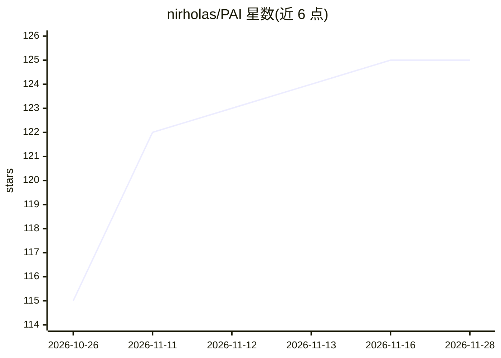

# nirholas/PAI

⭐ 125 · Shell · NOASSERTION · 推送 2026-11-14 · [GitHub](https://github.com/nirholas/PAI) · [官网](https://pai.direct) · 个人维护

**可启动的 Debian 12 live USB：离线本地运行 Ollama 的隐私 AI 桌面**

基于 Debian 12 live-build 构建的完整 live USB 操作系统，启动后全内存运行，不挂载宿主机硬盘，关机即清空。内置 Ollama 与 localhost Chat UI 提供本地推理，并集成 MAC 伪装、UFW 防火墙、Tor 可选透明代理、GnuPG/LUKS 加密、Electrum/Monero 钱包等工具。模型仅 CPU 推理（GPU 库被裁剪），支持任意 GGUF 模型；提供 Minimal（约 912 MB）与 Full（约 4–6 GB）两种 ISO。ISO 尚未发布，当前以 Dockerfile.build 从源码构建为主要路径。

## 筛选速览

| 维度 | 判定 | 备注 |
|---|---|---|
| AI 角色 | `ai-native` | 本体是模型或模型工具 |
| 许可风险 | `none` | NOASSERTION |
| 部署形态 | `self-host` | docker 或自建部署 |
| 模型依赖 | local-ok | 支持本地模型 |
| 硬件要求 | `cpu-ok` | |
| 安装摩擦 | `low` | 无编译、无系统依赖或容器化 |
| 成熟度 | — | 结构信号不足 |

## 能力要点

- 全内存 live 运行，不写宿主磁盘，关机清除全部会话状态
- 内置 Ollama 本地推理与 localhost Chat UI，无 API key、无云端依赖
- MAC 伪装 + UFW 防火墙 + Tor 可选透明代理的隐私加固
- 支持任意 GGUF 兼容模型（Llama 3.1、Mistral、Phi-3、Gemma、Qwen、DeepSeek 等）

## 适用场景

- 在借用的公共电脑上临时使用一个不留痕迹的 AI 工作环境
- 完全离线环境下与本地大模型对话
- 需要一个随身携带、隐私加固的整套桌面系统

## 场景标签

`聊天机器人` · 领域:对话与助手

## 证据(README 行号)

> L64: PAI is a **bootable live USB operating system** built on Debian 12 that gives you a private, portable AI workstatio
> L66: - **An offline AI assistant** running locally via Ollama — no cloud, no API keys, no data leaving your machine

## 星数曲线

2026-10-26 115 → 2026-11-28 125（+10）

---
*卡片 v1 · prompt 1.4 · 生成 2026-11-28 · 置信度 high · 依据 README sha `082558e7a904` · [字段定义](../../DATASET.md)*
