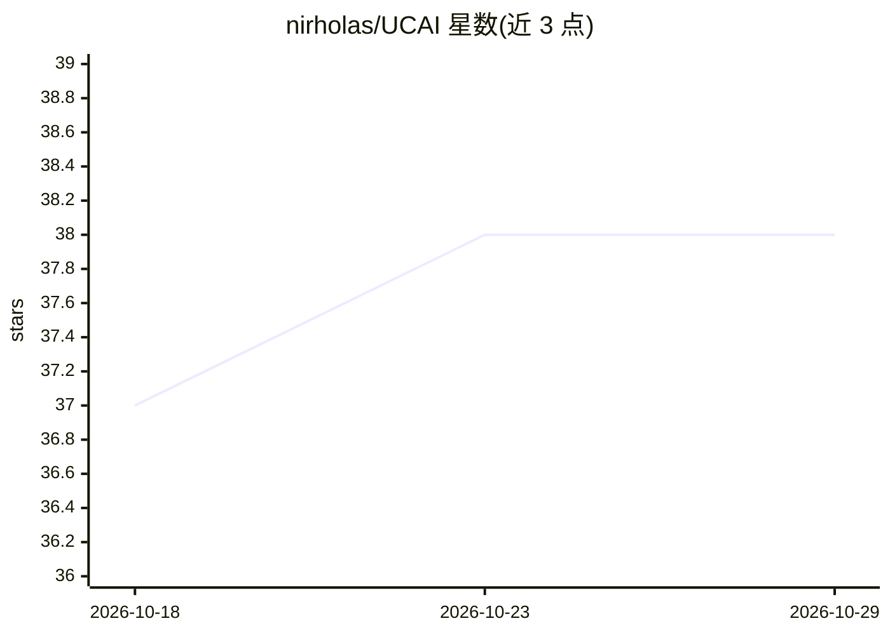

# nirholas/UCAI

⭐ 38 · Python · NOASSERTION · 推送 2026-10-09 · [GitHub](https://github.com/nirholas/UCAI) · [官网](https://ucai.tech) · 个人维护

**把智能合约 ABI 一键生成为 MCP 服务器的 CLI 工具**

abi-to-mcp 是 UCAI（Universal Contract AI Interface）标准的参考实现：读取合约地址或本地 ABI 文件，内省其函数与事件，生成生产可用的 MCP 服务器（含 server.py、类型映射、配置），使 Claude 等 AI agent 能以工具调用方式读写链上合约。写操作默认先走交易模拟，支持 --read-only 模式，私钥仅从环境变量加载。提供 inspect/validate 子命令，支持 Ethereum、Polygon、Arbitrum、Base 等 8 条 EVM 链，另有 mcp.ucai.tech 网页版（含安全扫描与合约解读）。面向 DeFi、DAO、钱包类 AI agent 开发者。

## 筛选速览

| 维度 | 判定 | 备注 |
|---|---|---|
| AI 角色 | `ai-ecosystem` | LLM/agent 周边工具 |
| 许可风险 | `none` | NOASSERTION |
| 部署形态 | `library` | 以包/库形式分发 |
| 模型依赖 | locked-api |  |
| 硬件要求 | — | 无带数字的原话,不猜 |
| 安装摩擦 | `low` | 无编译、无系统依赖或容器化 |
| 成熟度 | — | 结构信号不足 |

## 能力要点

- 一条命令从合约地址或 ABI 生成 MCP 服务器（15-30 个工具/合约）
- 写操作默认交易模拟，私钥仅从环境变量读取
- 安全扫描器检测 50+ 合约风险模式
- 支持 8 条 EVM 链与事件历史查询工具

## 适用场景

- 让 Claude 直接调用 Uniswap/Aave 等合约做链上操作
- 为 DeFi agent 或钱包助手快速搭建合约工具层
- 接入前扫描合约的 rug pull、蜜罐等风险

## 场景标签

`代码生成` `网络安全` · 领域:编码与开发

## 证据(README 行号)

> L2: ## The ABI-to-MCP Server Generator
> L126: *This package (`abi-to-mcp`) is the reference implementation of UCAI for MCP.*
> L136: **The Solution:** One command generates a production-ready MCP server from any ABI.

## 星数曲线

2026-10-18 37 → 2026-10-29 38（+1）

---
*卡片 v1 · prompt 1.4 · 生成 2026-10-25 · 置信度 high · 依据 README sha `c235fd134f7e` · [字段定义](../../DATASET.md)*
