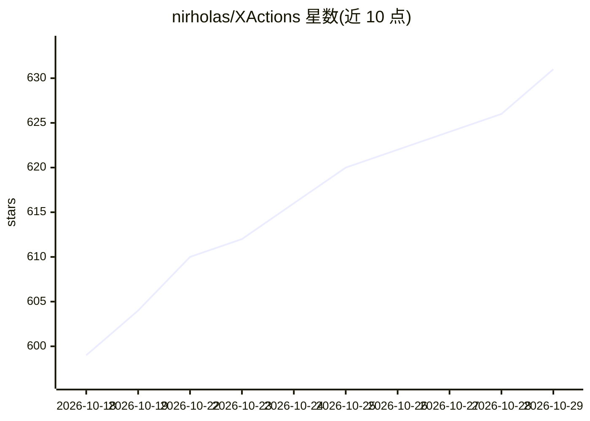

# nirholas/XActions

⭐ 631 · HTML · Apache-2.0 · 推送 2026-10-27 · [GitHub](https://github.com/nirholas/XActions) · [官网](https://xactions.app/features) · 个人维护

**X/Twitter 自动化工具集：爬取、自动化与面向 AI agent 的 MCP 服务器**

基于 Node.js/TypeScript 的 X/Twitter 自动化工具集，不使用官方 API key，通过 GraphQL 接口与浏览器 Cookie 完成资料/时间线抓取、搜索、关注、点赞、评论等操作。提供 154 个工具的 MCP 服务器供 Claude/GPT/Cursor 等 AI agent 调用，写操作可设人工审批门与每日配额，另含 56 命令 CLI、95 个浏览器控制台脚本、Manifest V3 浏览器扩展、声明式工作流引擎与插件系统，并支持 Bluesky/Mastodon/Threads 爬取。以 npm 包分发，Apache 2.0 许可。

## 筛选速览

| 维度 | 判定 | 备注 |
|---|---|---|
| AI 角色 | `ai-ecosystem` | LLM/agent 周边工具 |
| 许可风险 | `permissive` | Apache-2.0 |
| 部署形态 | `desktop` | 安装包/桌面程序 |
| 模型依赖 | — | README 未给出锁定关系 |
| 硬件要求 | — | 无带数字的原话,不猜 |
| 安装摩擦 | `low` | 无编译、无系统依赖或容器化 |
| 成熟度 | — | 结构信号不足 |

## 能力要点

- 154 个工具的 MCP 服务器，支持 Claude/GPT/Cursor 等 agent，含审批门与每日配额
- 无需 API key，通过 GraphQL 与浏览器 Cookie 读取和写入 X 数据
- 56 命令 CLI、95 个浏览器脚本与 Chrome/Edge 扩展三种使用形态
- 支持 X 官方数据归档导入并迁移到 Bluesky/Mastodon

## 适用场景

- 在终端或浏览器中批量抓取和分析 X 账号数据
- 让 Claude/GPT 等 AI agent 通过 MCP 操作 X 账号
- 批量取关不回关者、备份媒体、迁移到其他平台

## 场景标签

`浏览器自动化` `网页抓取` · 领域:效率与自动化

## 证据(README 行号)

> L14: Scrapers &nbsp;·&nbsp; MCP Server for AI Agents &nbsp;·&nbsp; CLI &nbsp;·&nbsp; Browser Scripts &nbsp;·&nbsp; Brows
> L22:  154 MCP Tools&nbsp;
> L124: > - Works with Claude, GPT, Cursor, Copilot via MCP server

## 星数曲线

2026-10-18 599 → 2026-10-29 631（+32）

---
*卡片 v1 · prompt 1.4 · 生成 2026-10-21 · 置信度 mid · 依据 README sha `dd0924dc7368` · [字段定义](../../DATASET.md)*
