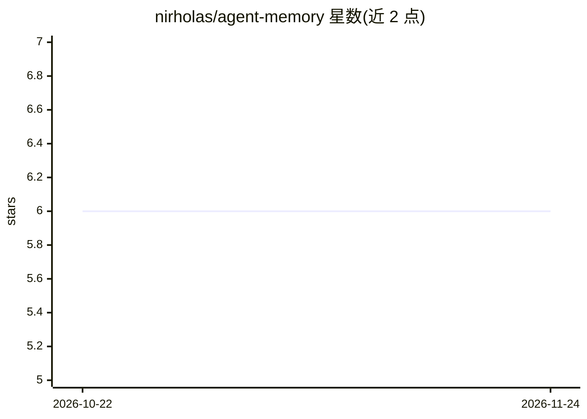

# nirholas/agent-memory

⭐ 6 · JavaScript · Apache-2.0 · 推送 2026-11-10 · [GitHub](https://github.com/nirholas/agent-memory) · [官网](https://nirholas.github.io/agent-memory/) · 组织维护

**给 AI agent 提供跨会话持久记忆的客户端 SDK**

three.ws Memory 引擎的官方 npm 客户端：agent 通过 remember()/recall() 存取事实，基于嵌入向量做语义检索，并自动抽取实体构建共现知识图谱。存储分 working/recall/archival 三层（Letta/MemGPT 模式），working 层带 2000 token 预算；嵌入默认 NVIDIA NIM 免费模型、OpenAI 作付费后备，向量按模型空间隔离打分。零运行时依赖，Node 18+ 与浏览器可用；写入需 three.ws 账号或 bearer token，读取仅限所有者，后端托管于 three.ws 服务（Postgres）。

## 筛选速览

| 维度 | 判定 | 备注 |
|---|---|---|
| AI 角色 | `ai-ecosystem` | LLM/agent 周边工具 |
| 许可风险 | `permissive` | Apache-2.0 |
| 部署形态 | `library` | 以包/库形式分发 |
| 模型依赖 | — | README 未给出锁定关系 |
| 硬件要求 | — | 无带数字的原话,不猜 |
| 安装摩擦 | `low` | 无编译、无系统依赖或容器化 |
| 成熟度 | — | 结构信号不足 |

## 能力要点

- remember/recall 语义检索，向量按嵌入模型空间隔离打分
- 三层记忆存储与 token 预算的 working core
- 确定性模式匹配自动抽取实体并构建共现图谱
- 无 provider 时退化为子串+显著度排序，不产生伪造相似度

## 适用场景

- 让 agent 跨会话记住用户偏好并在下次对话时语义召回
- 为交易类 agent 记录带结构化上下文的事件并按实体查询
- 管理 agent 的常驻上下文使其不超过 token 预算

## 场景标签

`Agent 记忆` · 领域:Agent 开发

## 证据(README 行号)

> L18: > `@three-ws/agent-memory` is the official client for the three.ws **Memory**
> L21: > meaning, not keyword: a real semantic search over stored vectors. It wraps the
> L22: > live `/api/agent-memory` and `/api/memory/*` endpoints — a tiered store
> L49: This is the SDK twin of the three.ws **Memory Studio** — the same engine, exposed

## 星数曲线

2026-10-22 6 → 2026-11-24 6（+0）

---
*卡片 v1 · prompt 1.4 · 生成 2026-11-20 · 置信度 high · 依据 README sha `338ea1250271` · [字段定义](../../DATASET.md)*
