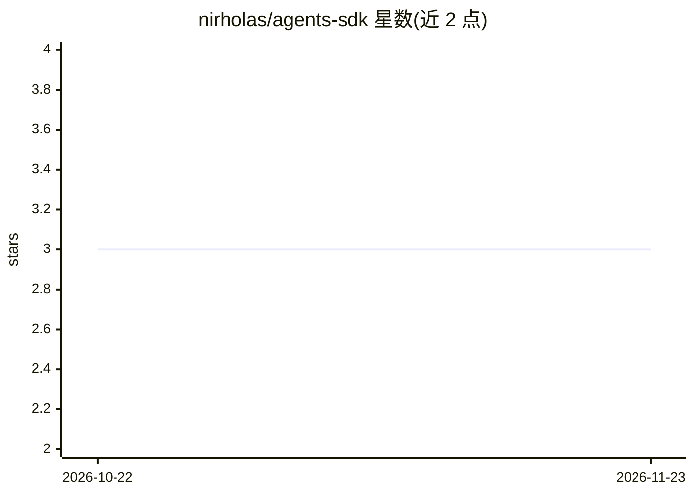

# nirholas/agents-sdk

⭐ 3 · TypeScript · Apache-2.0 · 推送 2026-11-10 · [GitHub](https://github.com/nirholas/agents-sdk) · [官网](https://nirholas.github.io/agents-sdk/) · 个人维护

**给开发者用的 three.ws Agents API 类型化 TypeScript 客户端**

面向 three.ws v1 Agents API 的类型化 TypeScript 客户端：用 API key 构建客户端后可创建/启动/停止 agent、进行对话、下达目标（runs）、调度自动化，并操作 Solana agent 钱包（转账、swap）。内置重试、超时、幂等键、类型化错误，资金操作需客户端 confirm 确认门。零运行时依赖，运行于 Node 20+/Deno/Bun/浏览器。README 声明包尚未发布到 npm，需从源码构建；大部分服务端路由尚未挂载，截至 2026-10-08 仅少量方法在生产可用。

## 筛选速览

| 维度 | 判定 | 备注 |
|---|---|---|
| AI 角色 | `ai-ecosystem` | LLM/agent 周边工具 |
| 许可风险 | `permissive` | Apache-2.0 |
| 部署形态 | `library` | 以包/库形式分发 |
| 模型依赖 | — | README 未给出锁定关系 |
| 硬件要求 | — | 无带数字的原话,不猜 |
| 安装摩擦 | `low` | 无编译、无系统依赖或容器化 |
| 成熟度 | `idea` | |

## 能力要点

- 零运行时依赖，支持 Node 20+/Deno/Bun/浏览器
- 每次资金移动调用前有客户端 confirm 确认门
- 幂等键跨重试复用，转账/swap 至多执行一次
- 完整类型定义与类型化错误类导出

## 适用场景

- 为我的 TypeScript 应用接入 three.ws 的 AI agent 服务
- 以编程方式管理带 Solana 钱包的 agent 生命周期
- 给 agent 下达目标并跟踪其运行步骤

## 场景标签

 · 领域:AI agent 基础设施/区块链

## 证据(README 行号)

> L10: **The typed TypeScript client for the three.ws v1 Agents API.**
> L13: run goals, schedule automations, and move funds from Solana agent wallets, with

## 星数曲线

2026-10-22 3 → 2026-11-23 3（+0）

---
*卡片 v1 · prompt 1.4 · 生成 2026-11-21 · 置信度 high · 依据 README sha `154497f51520` · [字段定义](../../DATASET.md)*
