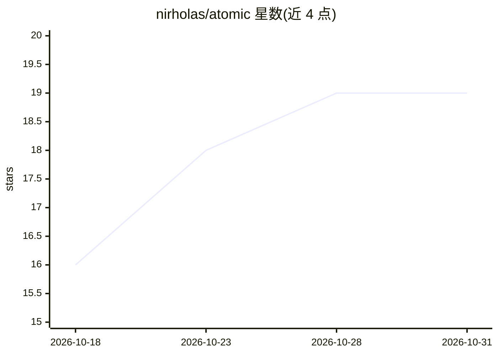

# nirholas/atomic

⭐ 19 · JavaScript · NOASSERTION · 推送 2026-10-11 · [GitHub](https://github.com/nirholas/atomic) · [官网](https://github.com/nirholas/atomic) · 个人维护

**Solana/pump.fun 代币的 Jito 原子化发行、收费与交易脚本集**

面向 Solana pump.fun 代币操作者的 CommonJS/TS 脚本工具集：通过 Jito bundle 将多笔交易打包为原子执行，覆盖代币元数据上传、代币发行（funder 与 creator 分离付费）、创建者费用归集、自动轮询归集、代币买入（经 Jupiter 聚合器）、SPL/Token-2022 原子转账与 USDC 持有者分润。全部脚本以环境变量配置，密钥从环境变量或本地 JSON 读取；附只读诊断工具（余额、bundle 状态、持有人集中度）与 Vitest 测试。仓库主题标签含 agents-md/llms-txt/claude 等，但 README 正文未展示 AI 相关功能。

## 筛选速览

| 维度 | 判定 | 备注 |
|---|---|---|
| AI 角色 | `ai-enhanced` | 去掉 AI 部分产品仍成立 |
| 许可风险 | `none` | NOASSERTION |
| 部署形态 | `library` | 以包/库形式分发 |
| 模型依赖 | — | README 未给出锁定关系 |
| 硬件要求 | — | 无带数字的原话,不猜 |
| 安装摩擦 | `low` | 无编译、无系统依赖或容器化 |
| 成熟度 | — | 结构信号不足 |

## 能力要点

- 两笔交易的 Jito bundle 原子发行：funder 支付租金+小费，creator 签署 createV2
- 单交易原子归集创建者费用并转往安全钱包，压缩抢跑机器人窗口
- watch-collect 轮询器按阈值自动触发归集 bundle
- 只读诊断工具：余额查询、bundle 状态、持有人集中度（Gini）

## 适用场景

- 以分离的 funder/creator 钱包原子化发行 pump.fun 代币
- 在密钥泄露或多签场景下将创建者费用原子转往安全钱包
- 经 Jupiter 用 Jito bundle 买入代币并原子转出

## 场景标签

 · 领域:区块链/加密交易工具

## 证据(README 行号)

> L33: Atomic scripts for launching, collecting fees from, and trading pump.fun coins. Built around **Jito bundles** for a
> L74: |`src/fire-jito.js`|`npm run launch`|**Launch via Jito bundle.** Two-tx bundle: funder pays rent + tip in Tx1; crea

## 星数曲线

2026-10-18 16 → 2026-10-31 19（+3）

---
*卡片 v1 · prompt 1.4 · 生成 2026-10-28 · 置信度 low · 依据 README sha `314e15352bdc` · [字段定义](../../DATASET.md)*
