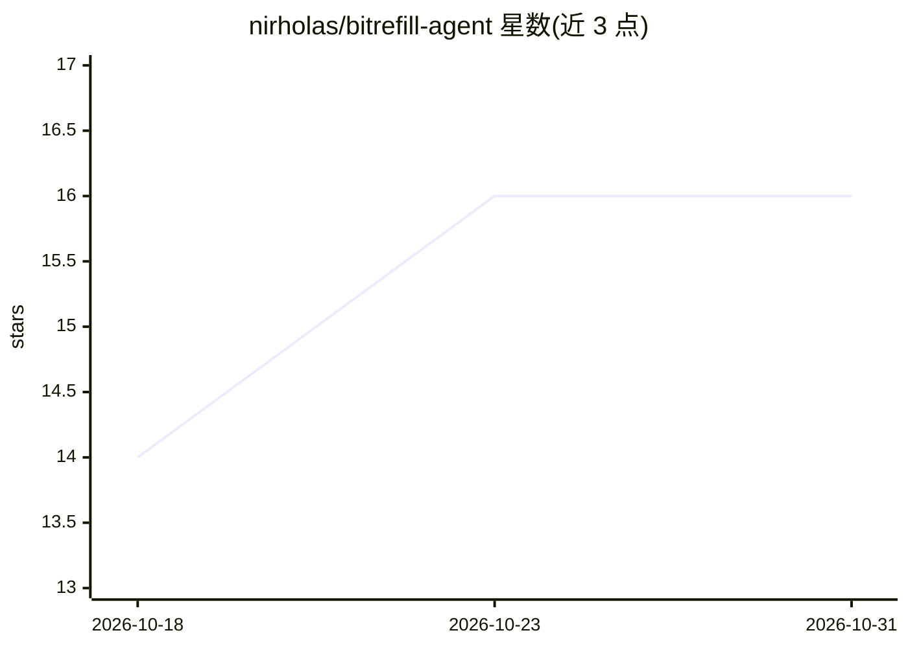

# nirholas/bitrefill-agent

⭐ 16 · TypeScript · NOASSERTION · 推送 2026-10-09 · [GitHub](https://github.com/nirholas/bitrefill-agent) · 个人维护

**SperaxOS 上的 Bitrefill 购物助手 Agent**

面向 SperaxOS 的 AI agent，通过 Bitrefill API 协助用户购买礼品卡、eSIM 与话费充值，覆盖 170+ 国家，支持加密货币或账户余额支付。提供完整购买流程（搜索→发票→加密支付→兑换码）、eSIM 管理与充值、账户余额查询、BRGC 批量礼品卡创建与联盟佣金追踪（后两者基于 Business API）。以 agent 配置 JSON 与英文 locale 文件形式提供，需复制到 nirholas/defi-agents 仓库使用；未见独立安装命令，许可证为保留所有权利（All rights reserved）。

## 筛选速览

| 维度 | 判定 | 备注 |
|---|---|---|
| AI 角色 | `ai-native` | 本体是模型或模型工具 |
| 许可风险 | `none` | NOASSERTION |
| 部署形态 | `None` |  |
| 模型依赖 | — | README 未给出锁定关系 |
| 硬件要求 | — | 无带数字的原话,不猜 |
| 安装摩擦 | `low` | 无编译、无系统依赖或容器化 |
| 成熟度 | — | 结构信号不足 |

## 能力要点

- 礼品卡/eSIM/话费搜索与完整购买流程（170+ 国家）
- eSIM 购买与已有 eSIM 充值管理
- Business API 的余额查询、加密充值与 BRGC 批量礼品卡创建
- 联盟佣金追踪与推荐订单分析

## 适用场景

- 通过对话完成 Bitrefill 礼品卡购买与加密支付
- 购买或充值旅行用 eSIM
- 批量创建礼品卡并追踪联盟佣金

## 场景标签

 · 领域:加密货币/电商 agent

## 证据(README 行号)

> L3: An AI agent for SperaxOS that helps users purchase gift cards, eSIMs, and mobile top-ups from 170+ countries using c
> L7: - Search gift cards, eSIMs, and mobile top-ups across 170+ countries

## 星数曲线

2026-10-18 14 → 2026-10-31 16（+2）

---
*卡片 v1 · prompt 1.4 · 生成 2026-10-30 · 置信度 high · 依据 README sha `60ba416efb6c` · [字段定义](../../DATASET.md)*
