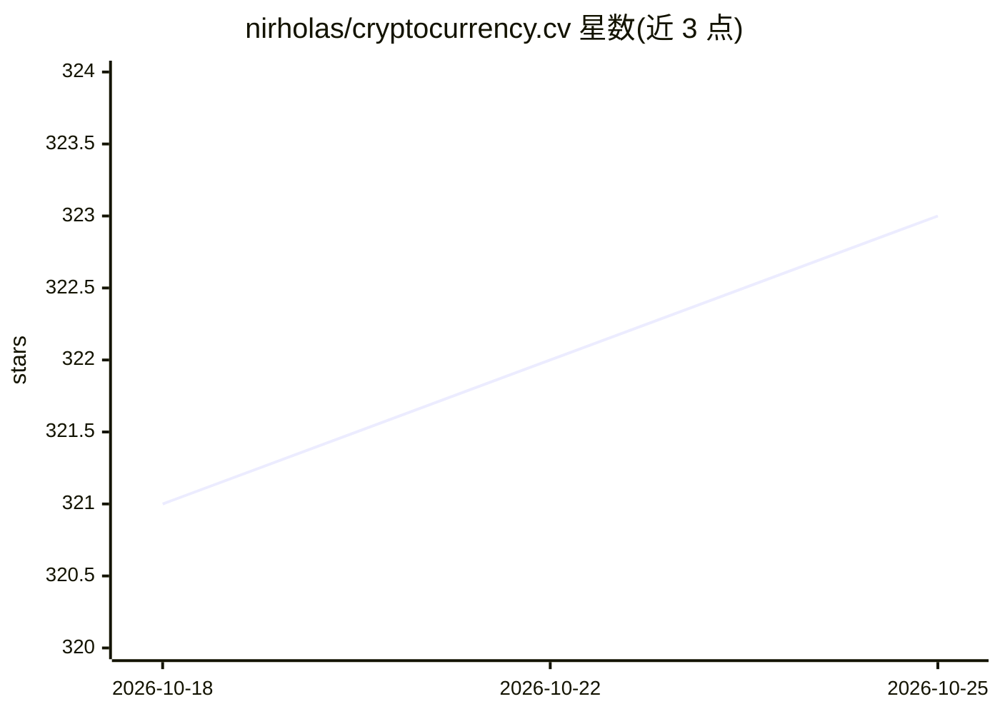

# nirholas/cryptocurrency.cv

⭐ 323 · TypeScript · NOASSERTION · 推送 2026-10-22 · [GitHub](https://github.com/nirholas/cryptocurrency.cv) · [官网](https://cryptocurrency.cv) · 个人维护

**免费加密货币新闻聚合 API：450+ 端点，无需 API key**

托管在 cryptocurrency.cv 的加密货币新闻数据服务：聚合 300+ RSS 来源（含 77 家国际媒体、18 种翻译目标），提供 450+ REST 端点，覆盖新闻、搜索、情感、市场数据、DeFi、巨鲸、组合与交易信号，并含 66 万篇可全文检索的历史归档（2017 年起，附行情上下文）。面向 AI agent 提供 MCP 服务器（托管+本地）、llms.txt、OpenAPI 与 12 种语言 SDK；AI 端点（摘要/情感/事实核查/RAG）由 Groq 驱动，自托管时需设 GROQ_API_KEY 才启用，不设则其余 API 功能完整可用。支持 Docker、Cloud Run、Vercel 等自托管。

## 筛选速览

| 维度 | 判定 | 备注 |
|---|---|---|
| AI 角色 | `ai-enhanced` | 去掉 AI 部分产品仍成立 |
| 许可风险 | `none` | NOASSERTION |
| 部署形态 | `self-host` | docker 或自建部署 |
| 模型依赖 | locked-api |  |
| 硬件要求 | — | 无带数字的原话,不猜 |
| 安装摩擦 | `low` | 无编译、无系统依赖或容器化 |
| 成熟度 | — | 结构信号不足 |

## 能力要点

- 450+ 端点、300+ 来源，无需 API key，RSS/Atom/SSE/WebSocket 多种输出
- 662,047 篇历史归档（2017 起），含 ticker、实体、情感与行情上下文
- MCP 服务器（托管 Streamable-HTTP + 本地 stdio，40+ 工具），兼容 Claude Desktop/Code、Cursor
- AI 端点（摘要、情感、事实核查、RAG、研究模式）由 Groq 驱动，自托管免费开启

## 适用场景

- 我在做加密行情看板，需要一条 HTTP 调用拉取多源新闻
- 给我的 AI agent 接上 MCP 工具，让它能查新闻、归档与情感数据
- 自托管一套新闻 API 并开启 AI 摘要和 RAG 功能

## 场景标签

`金融量化` · 领域:学习与行业

## 证据(README 行号)

> L36: Real-time crypto news from **300+ sources** with one HTTP call. No API key, no signup, no rate-limit paperwork. Liv
> L195: Everything runs from one Next.js app. All environment variables are optional; without any, you get the full news A
> L78: |**AI endpoints**|Summaries, sentiment, fact-checks, narratives, research mode, RAG over the archive, daily briefs.

## 星数曲线

2026-10-18 321 → 2026-10-25 323（+2）

---
*卡片 v1 · prompt 1.4 · 生成 2026-10-21 · 置信度 high · 依据 README sha `482a88b85dc5` · [字段定义](../../DATASET.md)*
