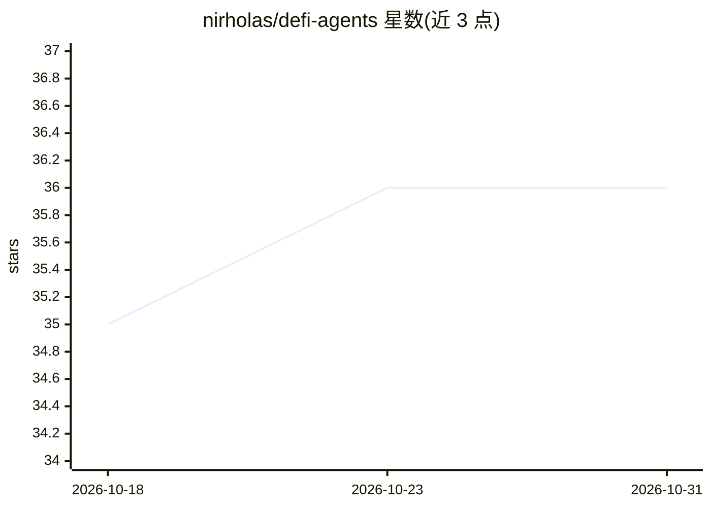

# nirholas/defi-agents

⭐ 36 · TypeScript · NOASSERTION · 推送 2026-10-10 · [GitHub](https://github.com/nirholas/defi-agents) · [官网](https://sperax.click) · 个人维护

**DeFi/Crypto AI agent 定义库：42 个 agent 的 JSON API**

托管 42 个面向 DeFi、组合管理、交易与 Web3 工作流的 AI agent 定义，以标准 JSON schema 通过 RESTful API（GitHub Pages CDN）分发，支持 18 种语言自动翻译。任何支持 agent index 的 AI 平台、LLM 或聊天机器人均可加载使用，agent 本身为纯 JSON 配置、在宿主平台本地执行。开发者可通过 git clone + bun 构建，或 fork 仓库提交自有 agent 并自动部署。注意：仓库声明为专有许可（Proprietary），SperaxOS 相关 agent 的域名尚未定稿，组合主 agent 目前仅实现只读追踪。

## 筛选速览

| 维度 | 判定 | 备注 |
|---|---|---|
| AI 角色 | `ai-knowledge` | 知识聚合/清单类 |
| 许可风险 | `none` | NOASSERTION |
| 部署形态 | `None` |  |
| 模型依赖 | — | README 未给出锁定关系 |
| 硬件要求 | — | 无带数字的原话,不猜 |
| 安装摩擦 | `low` | 无编译、无系统依赖或容器化 |
| 成熟度 | `idea` | |

## 能力要点

- 42 个 agent 定义覆盖 DeFi、交易、组合管理、安全教育
- RESTful JSON API + agents-manifest.json 机器可读索引，18 语言分发
- agent 为纯 JSON 配置，在宿主 AI 平台本地执行，无外部调用
- GitHub Pages 自动部署流程，支持自定义域名与社区 PR 提交

## 适用场景

- 为自己的 AI 平台或聊天机器人添加 DeFi/加密领域专家 agent
- 通过 JSON API 让 LLM 动态发现并加载 agent 定义
- 组合多个专家 agent（收益、风险、Gas）协作完成 DeFi 策略任务

## 场景标签

`金融量化` · 领域:学习与行业

## 证据(README 行号)

> L5: > **42 production-ready AI agent definitions for DeFi, portfolio management, trading, and Web3 workflows. RESTful JS
> L14: - ✅ **Machine-Readable Indexes** - Agent manifest for AI crawlers (agents-manifest.json)

## 星数曲线

2026-10-18 35 → 2026-10-31 36（+1）

---
*卡片 v1 · prompt 1.4 · 生成 2026-10-25 · 置信度 high · 依据 README sha `5af8385833db` · [字段定义](../../DATASET.md)*
