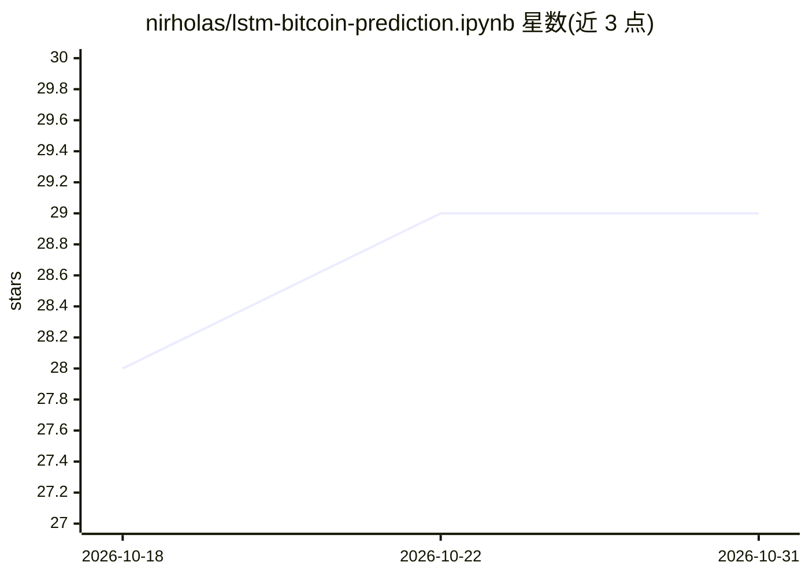

# nirholas/lstm-bitcoin-prediction.ipynb

⭐ 29 · Jupyter Notebook · NOASSERTION · 推送 2026-10-10 · [GitHub](https://github.com/nirholas/lstm-bitcoin-prediction.ipynb) · [官网](https://three.ws) · 个人维护

**单文件 Jupyter 笔记本：训练 LSTM 预测比特币日收盘价**

一个自包含的 Jupyter 笔记本：运行时从 CryptoCompare 公共端点下载 2000 天 BTC/USD 日线数据（无需 API key），按时间切分训练/测试集，构造 7 日窗口并归一化，训练 Keras 单层 LSTM（20 单元）模型，用 MAE 评估并绘制实际与预测价格及日收益率对比图。参数集中在单个单元格可调，改 fsym 可换资产。README 声明这是机器学习练习而非金融建议，训练结果已提交在笔记本内可直接阅读。

## 筛选速览

| 维度 | 判定 | 备注 |
|---|---|---|
| AI 角色 | `ai-native` | 本体是模型或模型工具 |
| 许可风险 | `none` | NOASSERTION |
| 部署形态 | `library` | 以包/库形式分发 |
| 模型依赖 | — | README 未给出锁定关系 |
| 硬件要求 | — | 无带数字的原话,不猜 |
| 安装摩擦 | `low` | 无编译、无系统依赖或容器化 |
| 成熟度 | — | 结构信号不足 |

## 能力要点

- 运行时自动下载数据，笔记本自包含可直接运行
- 7 日窗口归一化学习相对变化而非绝对价格
- 所有超参数集中在单个单元格，可换资产符号建模
- 输出图表与指标已提交，可在 GitHub 上直接阅读

## 适用场景

- 学习 LSTM 时间序列建模的完整流程
- 对比模型预测与真实日收益率的样本外表现
- 作为模板替换资产符号做其他币种实验

## 场景标签

`金融量化` `教程课程` · 领域:学习与行业

## 证据(README 行号)

> L5: A single Jupyter notebook that trains an LSTM neural network to predict the daily closing price of Bitcoin (BTC/USD)
> L14: 4. **Builds the model** — Keras `Sequential`: one `LSTM` layer (20 units) → `Dropout` (0.25) → `Dense(1)` → linear 

## 星数曲线

2026-10-18 28 → 2026-10-31 29（+1）

---
*卡片 v1 · prompt 1.4 · 生成 2026-10-26 · 置信度 high · 依据 README sha `c093ab8adcc9` · [字段定义](../../DATASET.md)*
