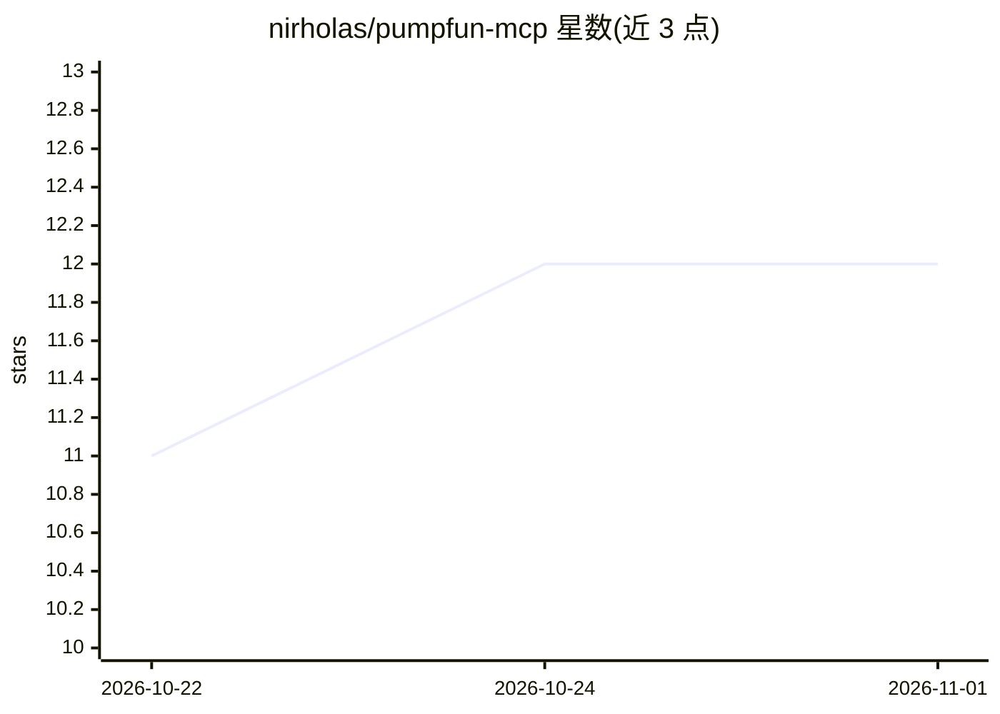

# nirholas/pumpfun-mcp

⭐ 12 · JavaScript · Apache-2.0 · 推送 2026-10-10 · [GitHub](https://github.com/nirholas/pumpfun-mcp) · [官网](https://nirholas.github.io/pumpfun-mcp/) · 组织维护

**pump.fun/Solana 只读 MCP 服务器：给 AI 客户端链上代币数据**

面向 Claude 等任意 MCP 客户端的 stdio 服务器，提供 pump.fun 与 Solana 链上只读数据工具：代币发现与搜索、bonding curve 与持仓分析、创建者费申领追踪、SNS 域名解析、KOL 排行、AMM 换币报价及可分享的 3D 代币快照。本体是 stdio↔HTTP 桥，RPC 调用在 three.ws 后端执行，客户端无需 API key。六个工具依赖可选的 indexer 配置，未配置时被过滤；Node.js >= 20，经 npx 或全局 npm 安装运行。

## 筛选速览

| 维度 | 判定 | 备注 |
|---|---|---|
| AI 角色 | `ai-ecosystem` | LLM/agent 周边工具 |
| 许可风险 | `permissive` | Apache-2.0 |
| 部署形态 | `library` | 以包/库形式分发 |
| 模型依赖 | — | README 未给出锁定关系 |
| 硬件要求 | — | 无带数字的原话,不猜 |
| 安装摩擦 | `low` | 无编译、无系统依赖或容器化 |
| 成熟度 | — | 结构信号不足 |

## 能力要点

- 20+ 只读工具：代币发现、bonding curve、持仓集中度、费申领追踪
- stdio↔HTTP 桥架构，后端执行 RPC，客户端零配置无 API key
- pumpfun_token_3d 原生工具生成可分享 3D 代币快照（深链+iframe）
- 六个 indexer 门控工具按 PUMPFUN_BOT_URL 配置动态增减

## 适用场景

- 在 Claude/Cursor 中用自然语言查询 pump.fun 代币链上数据
- 追踪创建者费申领与大额交易等信号
- 为代币生成可分享的 3D 快照页面

## 场景标签

`数据分析` · 领域:效率与自动化

## 证据(README 行号)

> L20: > A free, read-only Model Context Protocol server for **pump.fun** and **Solana**. It gives Claude — or any MCP cli
> L53: The server speaks stdio JSON-RPC — your MCP client spawns it via the `npx` command above. Once configured, ask your

## 星数曲线

2026-10-22 11 → 2026-11-01 12（+1）

---
*卡片 v1 · prompt 1.4 · 生成 2026-11-01 · 置信度 high · 依据 README sha `b6c80344635b` · [字段定义](../../DATASET.md)*
