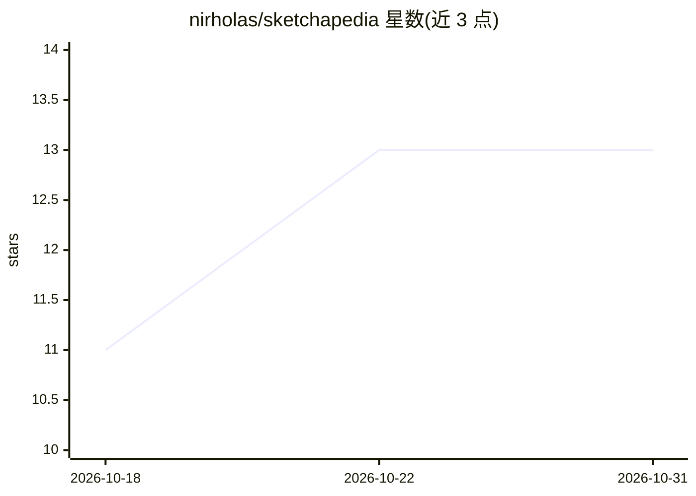

# nirholas/sketchapedia

⭐ 13 · TypeScript · NOASSERTION · 推送 2026-10-24 · [GitHub](https://github.com/nirholas/sketchapedia) · [官网](https://nirholas.github.io/sketchapedia/) · 个人维护

**用生成模型渲染 UI 像素、叠加隐形可访问逻辑层的 TS SDK**

实验性 TypeScript SDK，提出 Model-as-a-Renderer 架构：LLM 生成布局与 hitmap，图像模型（FLUX + ControlNet）渲染关键帧，视频模型（LTX-Video）渲染过渡动画，绘制到 canvas；其上覆盖隐形 DOM 层（真实 input/button、ARIA 标签、屏幕阅读器、键盘导航），由平台处理输入与可访问性。像素内容寻址并经 CDN 缓存，GPU 仅在新的状态转换时消耗。面向前端开发者；仓库根目录保留原型 sketch，正式 SDK 按分阶段 prompts 构建，未见成品发布。

## 筛选速览

| 维度 | 判定 | 备注 |
|---|---|---|
| AI 角色 | `ai-ecosystem` | LLM/agent 周边工具 |
| 许可风险 | `none` | NOASSERTION |
| 部署形态 | `library` | 以包/库形式分发 |
| 模型依赖 | — | README 未给出锁定关系 |
| 硬件要求 | — | 无带数字的原话,不猜 |
| 安装摩擦 | `low` | 无编译、无系统依赖或容器化 |
| 成熟度 | `idea` | |

## 能力要点

- LLM 生成布局+hitmap，FLUX/ControlNet 渲染关键帧，LTX-Video 渲染过渡
- 隐形 DOM 逻辑层保留输入、IME、密码管理器、屏幕阅读器支持
- 内容寻址像素经 CDN 缓存，GPU 仅在新的状态转换时消耗
- 提供 AGENTS.md / llms.txt 供编码 agent 直接读取

## 适用场景

- 探索非矩形、AI 渲染的前端界面构建方式
- 在保留可访问性与表单能力的前提下实验生成式 UI
- 让 AI agent 直接读取仓库上下文进行协作开发

## 场景标签

 · 领域:前端/生成式 UI

## 证据(README 行号)

> L7: Sketchapedia is *Model-as-a-Renderer* (MaaR) — replacing the DOM/CSS/JS rendering pipeline with a generative image/v
> L17: 1. **Generative pixel layer.** An LLM emits a layout + hitmap; an image model (FLUX + ControlNet) renders keyframes

## 星数曲线

2026-10-18 11 → 2026-10-31 13（+2）

---
*卡片 v1 · prompt 1.4 · 生成 2026-10-31 · 置信度 mid · 依据 README sha `ddcc5cc00b0a` · [字段定义](../../DATASET.md)*
