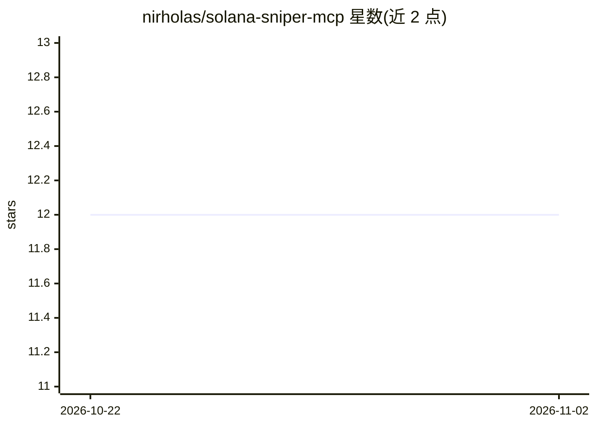

# nirholas/solana-sniper-mcp

⭐ 12 · JavaScript · Apache-2.0 · 推送 2026-11-01 · [GitHub](https://github.com/nirholas/solana-sniper-mcp) · [官网](https://nirholas.github.io/solana-sniper-mcp/) · 个人维护

**供 3D AI agent 使用的 pump.fun 打新交易引擎（库/CLI/MCP/付费API）**

可嵌入的 pump.fun 自动打新交易引擎：单一交易循环接收新发射事件流，按每个 agent 的策略评分，跑预交易守卫（并发/日预算/强制止损），执行买入并按止损/止盈/追踪止损/超时/情绪翻转退出。多 agent 多用户隔离（每 agentId 一钱包），钱包/存储/RPC/行情源均为可插拔适配器。同一引擎提供四种交付形态：npm 库、CLI、MCP stdio server（7 个工具映射引擎方法）、x402 USDC 微付费 HTTP API 及内置运营控制台。默认 simulate 模式，live 模式交易真实资金；要求 Node >= 20。

## 筛选速览

| 维度 | 判定 | 备注 |
|---|---|---|
| AI 角色 | `ai-ecosystem` | LLM/agent 周边工具 |
| 许可风险 | `permissive` | Apache-2.0 |
| 部署形态 | `library` | 以包/库形式分发 |
| 模型依赖 | — | README 未给出锁定关系 |
| 硬件要求 | — | 无带数字的原话,不猜 |
| 安装摩擦 | `low` | 无编译、无系统依赖或容器化 |
| 成熟度 | — | 结构信号不足 |

## 能力要点

- 五类适配器（Feed/Solana/Wallet/Executor/Store）可替换，支持内存或 SQLite/Postgres 等后端
- MCP server 将引擎方法 1:1 暴露为工具，接入 Claude Desktop/Cursor 等 MCP 客户端
- x402 微付费 HTTP API：写操作按 USDC 计价（$0.005–$0.05），读操作免费，附内置运营控制台
- 多 agent 隔离：一 agent 一钱包、每策略日预算/并发上限、强制 stop_loss_pct、幂等 claim 防重复买入

## 适用场景

- 为 AI agent（MCP 客户端）提供 pump.fun 自动交易能力
- 本地以 simulate 模式在 devnet 上测试打新策略后再切 live
- 托管多租户部署，通过 x402 付费 API 向外部 agent 收费提供服务

## 场景标签

`金融量化` · 领域:学习与行业

## 证据(README 行号)

> L106: `agent-sniper mcp` exposes the engine as an MCP stdio server. Every tool maps
> L120: Wire it into an MCP client (Claude Desktop, Cursor, etc.):

## 星数曲线

2026-10-22 12 → 2026-11-02 12（+0）

---
*卡片 v1 · prompt 1.4 · 生成 2026-11-01 · 置信度 high · 依据 README sha `bf0c97d34e31` · [字段定义](../../DATASET.md)*
