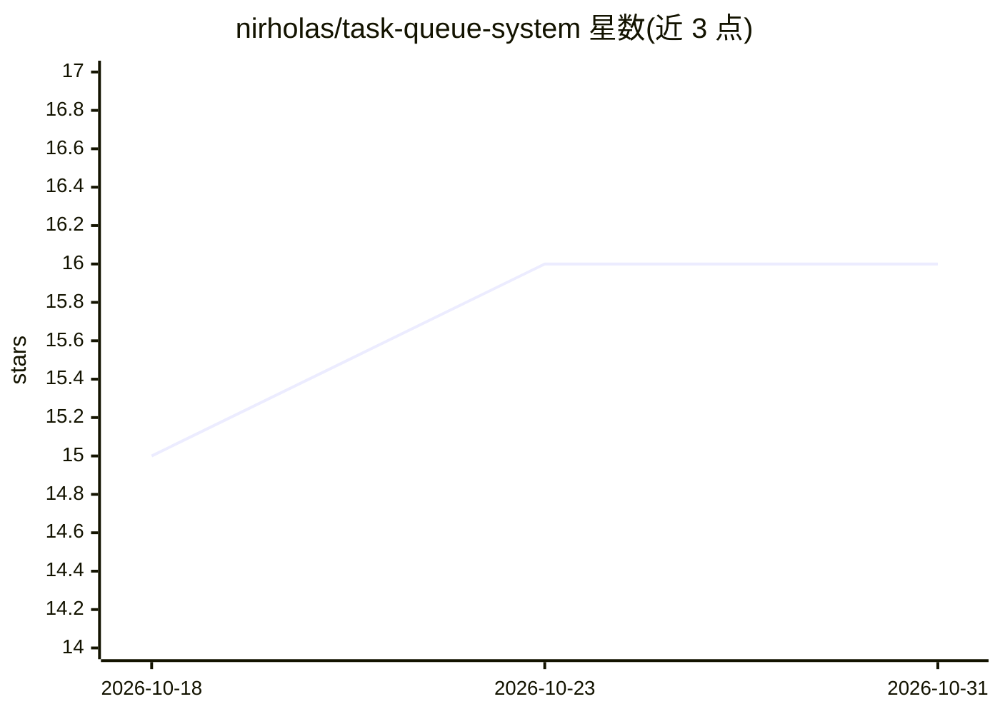

# nirholas/task-queue-system

⭐ 16 · NOASSERTION · 推送 2026-10-10 · [GitHub](https://github.com/nirholas/task-queue-system) · [官网](https://three.ws) · 个人维护

**把任务编号分派到多个 VS Code Copilot 并行会话的移植指南**

一套可复制到任意 Git 仓库的文件模板与操作指南：将大任务拆为编号的 .md 任务文件并写入 TASK-MANIFEST.md 索引，在 .github/agents/ 放置 task-runner 与 prompt-writer 两个 agent 定义文件；用户在多个 VS Code Copilot Chat 中输入 @task-runner <编号>，agent 依据清单读取对应任务文件并执行。支持自定义验证命令、仓库约定与清单再生成。本体不含代码运行时，是文档加模板文件的组合，需依赖 VS Code Copilot 环境使用。

## 筛选速览

| 维度 | 判定 | 备注 |
|---|---|---|
| AI 角色 | `ai-ecosystem` | LLM/agent 周边工具 |
| 许可风险 | `none` | NOASSERTION |
| 部署形态 | `None` |  |
| 模型依赖 | — | README 未给出锁定关系 |
| 硬件要求 | — | 无带数字的原话,不猜 |
| 安装摩擦 | `low` | 无编译、无系统依赖或容器化 |
| 成熟度 | — | 结构信号不足 |

## 能力要点

- 任务 .md 文件 + TASK-MANIFEST.md 编号索引的分派机制
- task-runner / prompt-writer 两个 agent 定义文件
- README 声明支持 50+ 并行 agent 会话、零手工复制粘贴
- 提供按仓库定制验证命令与约定的说明（PROMPT-SPEC.md）

## 适用场景

- 把大型改造工作拆成编号任务并分派到多个 Copilot 会话并行执行
- 让 @prompt-writer 按仓库规范批量生成新任务文件
- 将此模板复制到其他仓库复用同一套任务分派流程

## 场景标签

`提示工程` `多智能体` · 领域:Agent 开发

## 证据(README 行号)

> L12: 3. Open 50 VS Code Copilot chats
> L94: The agent reads `TASK-MANIFEST.md`, finds the file path, reads the prompt, executes it.
> L228: |`.github/agents/task-runner.agent.md`|Executes tasks by number|✅ Yes|

## 星数曲线

2026-10-18 15 → 2026-10-31 16（+1）

---
*卡片 v1 · prompt 1.4 · 生成 2026-10-30 · 置信度 high · 依据 README sha `df755a209da8` · [字段定义](../../DATASET.md)*
