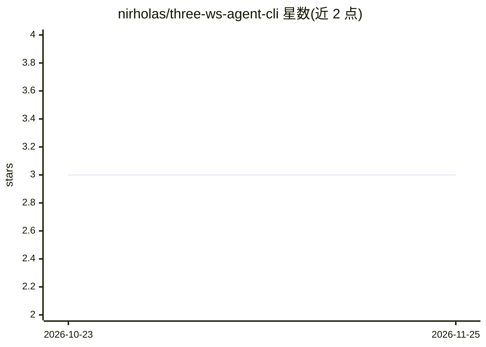

# nirholas/three-ws-agent-cli

⭐ — · [GitHub]() · 个人维护

**在本地机器运行 three.ws 平台 agent 的运行时**

three.ws agent 的本地运行时包：在本机跑与服务端相同的 agent 循环（@three-ws/agent-runtime），本地工具提供受限沙箱内的文件读写与 shell 执行、网页抓取为 Markdown，远程工具经 Streamable HTTP 挂载 three.ws MCP 服务器。每次工具调用按 read/write/shell/network/financial 五类走审批门，financial 类配置为 allow 会被强制读作 ask。会话存于 SQLite（WAL 模式，含 FTS5 全文检索）。注意：CLI 命令与终端 UI 尚未入库，包未发布到 npm，目前只能按路径引用仓库内模块。

## 筛选速览

| 维度 | 判定 | 备注 |
|---|---|---|
| AI 角色 | `ai-ecosystem` | LLM/agent 周边工具 |
| 许可风险 | `permissive` | — |
| 部署形态 | `library` | 以包/库形式分发 |
| 模型依赖 | local-ok | 支持本地模型 |
| 硬件要求 | — | 无带数字的原话,不猜 |
| 安装摩擦 | `low` | 无编译、无系统依赖或容器化 |
| 成熟度 | `idea` | |

## 能力要点

- 本地文件与 shell 工具运行在资源受限沙箱，环境变量按关键词脱敏
- 五类工具审批门，financial 类禁止配置为 allow
- 挂载 three.ws MCP 服务器工具，按相关性每轮选取前 maxTools 个
- SQLite 会话存储含全文检索、cron 调度与会话导出

## 适用场景

- 在自己机器上运行 three.ws agent 处理本地文件与 shell 任务
- 将 three.ws 平台工具接入本地 OpenAI 兼容模型端点
- 需要每个高风险工具调用经人工审批的 agent 运行环境

## 场景标签

`AI 助手` · 领域:对话与助手

## 证据(README 行号)

> L10: **Run a three.ws agent on your own machine: the platform's tools and wallet over MCP, your files and shell in a san
> L12: This package is the local runtime behind `three-ws-agent`. It runs the same
> L18: - **remote**: every tool on the three.ws MCP servers (`/api/mcp-agent` and

## 星数曲线

2026-10-23 3 → 2026-11-25 3（+0）

---
*卡片 v1 · prompt 1.4 · 生成 2026-11-21 · 置信度 high · 依据 README sha `5abc8901c0b4` · [字段定义](../../DATASET.md)*
