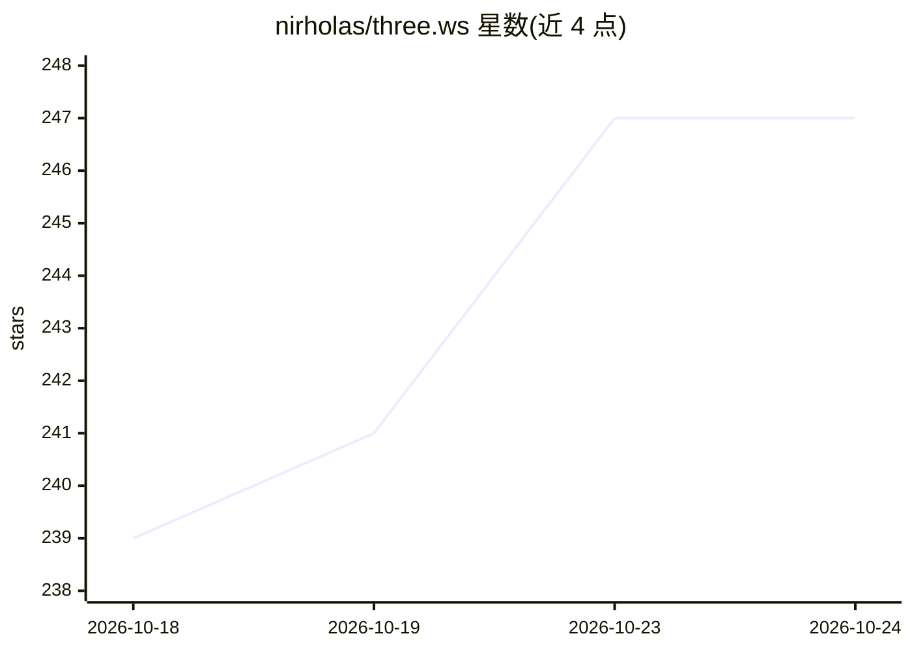

# nirholas/three.ws

⭐ 249 · JavaScript · Apache-2.0 · 推送 2026-10-24 · [GitHub](https://github.com/nirholas/three.ws) · [官网](https://three.ws) · 组织维护

**浏览器端 3D AI agent 平台：文本/图片生成可动 GLB 虚拟形象并嵌入网页**

开源（Apache-2.0）的浏览器原生 3D AI agent 平台：Forge 组件将文本、图片或草图生成带贴图的 3D 模型（GLB），也可导入已有 GLB；随后可为形象接入 LLM 大脑、注册上链，通过一个 Web 组件嵌入任意网页，无需插件、服务器上传或安装。提供免费草稿档、无账号试用（three.ws/forge），并附带远程 MCP 服务器、x402 支付与 readme-3d 工具包（在 GitHub README 中嵌入 3D 模型）。面向想在网页中构建和部署 3D AI 虚拟形象的开发者与创作者。

## 筛选速览

| 维度 | 判定 | 备注 |
|---|---|---|
| AI 角色 | `ai-native` | 本体是模型或模型工具 |
| 许可风险 | `permissive` | Apache-2.0 |
| 部署形态 | `None` |  |
| 模型依赖 | — | README 未给出锁定关系 |
| 硬件要求 | — | 无带数字的原话,不猜 |
| 安装摩擦 | `low` | 无编译、无系统依赖或容器化 |
| 成熟度 | — | 结构信号不足 |

## 能力要点

- 文本→3D、图片→3D、草图→3D 生成带贴图 GLB 模型
- LLM 大脑 + 记忆 + 钱包的 agent 化虚拟形象
- 单个 Web 组件嵌入任意网页，无需插件与服务器上传
- 附带 readme-3d 开源工具包，可在 GitHub README 中嵌入交互式 3D 模型

## 适用场景

- 用一句话或一张照片生成可绑骨动画的 3D 虚拟形象
- 为 3D 形象接入 LLM 做对话式 AI agent 并嵌入个人网站
- 在 GitHub README/Issue 中展示交互式 3D 模型

## 场景标签

`聊天机器人` · 领域:对话与助手

## 证据(README 行号)

> L9: **Give your AI a body.** three.ws is an open source (Apache-2.0), browser-native 3D AI agent platform. Type a prompt
> L11: > **Try it in 60 seconds:** open three.ws/forge, type *"a brass steampunk owl, full body"*, and download the GLB. T

## 星数曲线

2026-10-18 239 → 2026-10-24 247（+8）

---
*卡片 v1 · prompt 1.4 · 生成 2026-10-22 · 置信度 mid · 依据 README sha `f34b93a6510b` · [字段定义](../../DATASET.md)*
