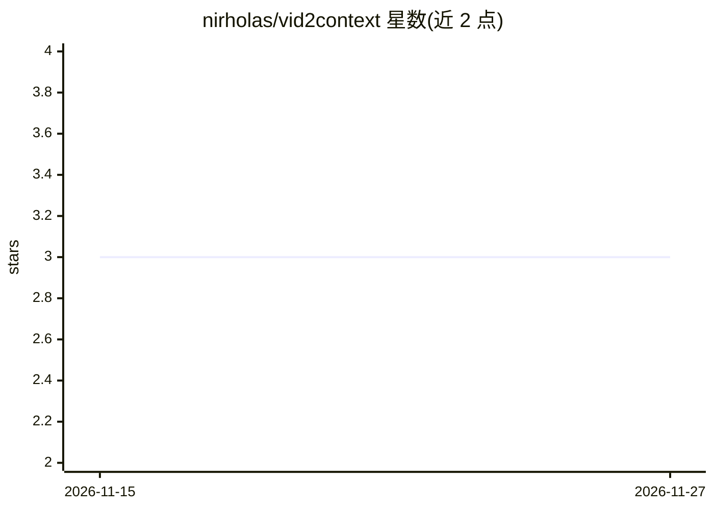

# nirholas/vid2context

⭐ 3 · TypeScript · Apache-2.0 · 推送 2026-11-26 · [GitHub](https://github.com/nirholas/vid2context) · [官网](https://vid2context.com) · 个人维护

**把视频转成带时间戳上下文的 MCP 服务器与 CLI，供 AI agent 引用**

提供 MCP 服务器（stdio 与远程 HTTP）、CLI、HTTP API 和库四种形态，将 YouTube、Bilibili、播客及 yt-dlp 支持的 1,000+ 站点的视频解析为字幕、转录、元数据、章节与可引用的 context pack，输出文本/JSON/Markdown/SRT/VTT 等格式。转录按 fallback 链依次尝试创作者字幕、平台自动字幕、本地 whisper.cpp 语音识别与托管服务；LLM 步骤按 local→free→keyless→paid 分层（tier）链执行，零配置即可运行。需要 Node.js 22+，支持 Docker 部署。

## 筛选速览

| 维度 | 判定 | 备注 |
|---|---|---|
| AI 角色 | `ai-ecosystem` | LLM/agent 周边工具 |
| 许可风险 | `permissive` | Apache-2.0 |
| 部署形态 | `library` | 以包/库形式分发 |
| 模型依赖 | local-ok | 支持本地模型 |
| 硬件要求 | — | 无带数字的原话,不猜 |
| 安装摩擦 | `medium` | 含编译或系统依赖之一 |
| 成熟度 | — | 结构信号不足 |

## 能力要点

- stdio MCP 服务器暴露 28 个工具，支持带时间戳引用的问答与跨视频 brief
- rung 链机制：按 local/free/keyless/paid 分层回退，记录每次尝试
- 本地 whisper.cpp 与 Transformers.js 离线语音识别，原始转录始终保留
- 支持 CLI、HTTP API、web 应用、浏览器扩展及 Telegram/Discord/Slack 机器人等多种接入面

## 适用场景

- 让 agent 观看并引用视频课程或播客内容回答问题
- 批量把播放列表转成可上传到 ChatGPT/Claude Projects 的 context pack
- 本地文件音视频的离线转录与章节生成

## 场景标签

`RAG` `语音识别` · 领域:知识与检索

## 证据(README 行号)

> L5: **Turn any video into context for AI agents.** An MCP server, CLI, HTTP API and library that gives Claude, ChatGPT, 
> L40: Each speech-to-text and LLM step runs through a **rung chain**. A rung is one provider, one model and one credentia
> L121: The MCP server is the npm package `vid2context-mcp`, listed in the MCP Registry as `io.github.nirholas/vid2context

## 星数曲线

2026-11-15 3 → 2026-11-27 3（+0）

---
*卡片 v1 · prompt 1.4 · 生成 2026-11-21 · 置信度 high · 依据 README sha `8e100e5a3575` · [字段定义](../../DATASET.md)*
