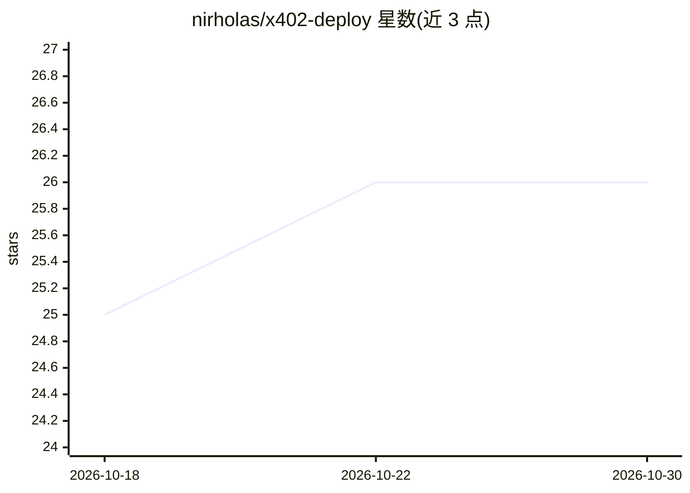

# nirholas/x402-deploy

⭐ 26 · TypeScript · NOASSERTION · 推送 2026-10-29 · [GitHub](https://github.com/nirholas/x402-deploy) · [官网](https://nirholas.github.io/x402-deploy/) · 个人维护

**给 API/MCP 服务器开发者：一键部署并按调用收费**

CLI 部署工具：自动检测 MCP 服务器、Express、Fastify、FastAPI、Next.js 等项目类型，将现有 API 包上一层 x402 支付网关（按调用收取 Base 链上的 USDC），付款验证通过后才放行 API 访问。支持一键部署到 Railway、Fly.io、Vercel 或 Docker，并提供终端实时收益面板与 x402scan.com 自动收录。无需改动原有代码，以 npm 全局安装使用。限制：托管面板与站点演示当前因迁移离线。

## 筛选速览

| 维度 | 判定 | 备注 |
|---|---|---|
| AI 角色 | `ai-ecosystem` | LLM/agent 周边工具 |
| 许可风险 | `none` | NOASSERTION |
| 部署形态 | `library` | 以包/库形式分发 |
| 模型依赖 | — | README 未给出锁定关系 |
| 硬件要求 | — | 无带数字的原话,不猜 |
| 安装摩擦 | `low` | 无编译、无系统依赖或容器化 |
| 成熟度 | — | 结构信号不足 |

## 能力要点

- 按调用计费的 x402 加密支付网关（USDC on Base），付款验证后才放行 API
- 自动检测并配置 MCP 服务器及 5 类 Node.js/Python 项目类型
- 一键部署到 Railway、Fly.io、Vercel 或 Docker（约 30 秒-3 分钟）
- 终端实时收益面板与 x402scan.com 自动收录

## 适用场景

- 把我的 MCP 服务器变成按调用收费的付费服务
- 为 GPT 封装、embedding 等 AI API 增加按次计费
- 给现有 REST/HTTP API 加加密支付访问控制

## 场景标签

 · 领域:AI 基础设施/API 变现

## 证据(README 行号)

> L7: Turn any API or MCP server into a paid service in **5 minutes**. No code changes required.
> L47: - **MCP Servers** - Monetize Claude Desktop tools
> L75: - ✅ MCP Servers (`@modelcontextprotocol/sdk`)

## 星数曲线

2026-10-18 25 → 2026-10-30 26（+1）

---
*卡片 v1 · prompt 1.4 · 生成 2026-10-26 · 置信度 high · 依据 README sha `7a26f0cab6c5` · [字段定义](../../DATASET.md)*
