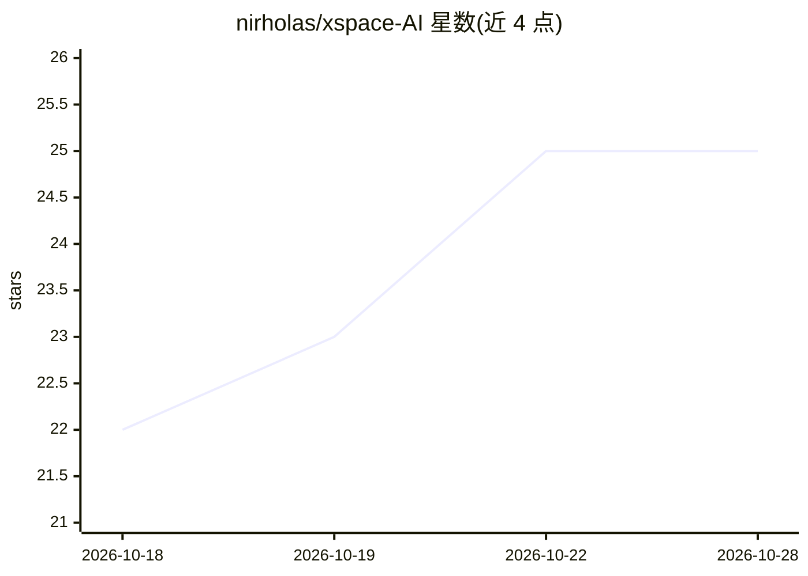

# nirholas/xspace-AI

⭐ 25 · TypeScript · NOASSERTION · 推送 2026-10-28 · [GitHub](https://github.com/nirholas/xspace-AI) · [官网](https://nirholas.github.io/xspace-AI/) · 个人维护

**构建能自主加入并发言于 X/Twitter Spaces 的 AI 语音 agent 的 SDK/CLI**

TypeScript SDK 与 CLI，用于构建自动加入、监听并参与 X/Twitter Spaces 语音对话的 AI agent。通过 Puppeteer 无头 Chromium 连接 Space 的 WebRTC 音频流，经可配置的 STT→LLM→TTS 管道生成语音回复，各阶段支持中间件；支持多 agent 轮次管理、管理面板与插件扩展。LLM 可接 OpenAI/Anthropic/Groq 或任意 OpenAI 兼容 API，STT 支持 Deepgram/Whisper，TTS 支持 ElevenLabs/OpenAI。需 Node.js>=18、Chromium 与 X 账号 cookie 认证；工作区包尚未发布到 npm，CLI 需从源码运行。

## 筛选速览

| 维度 | 判定 | 备注 |
|---|---|---|
| AI 角色 | `ai-ecosystem` | LLM/agent 周边工具 |
| 许可风险 | `none` | NOASSERTION |
| 部署形态 | `self-host` | docker 或自建部署 |
| 模型依赖 | local-ok | 支持本地模型 |
| 硬件要求 | — | 无带数字的原话,不猜 |
| 安装摩擦 | `low` | 无编译、无系统依赖或容器化 |
| 成熟度 | `idea` | |

## 能力要点

- Puppeteer 接入 X Spaces 的 WebRTC 音频流，STT→LLM→TTS 全管道可配置并支持中间件
- 多 agent 团队与轮次管理，含多空格调度
- 零代码 CLI（join/auth/dashboard 等命令）与管理面板
- 12 个可运行示例工程（多 agent 辩论、Discord 桥接、本地 Ollama 后端等）

## 适用场景

- 让 AI agent 加入 X Space 实时参与语音对话
- 搭建多 agent 直播辩论或轮播节目
- 监听并转写 Space 音频生成带时间戳的记录
- 通过 Discord 远程控制 agent 的加入与发言

## 场景标签

`语音 Agent` `多智能体` · 领域:Agent 开发

## 证据(README 行号)

> L21: X Space Agent is a TypeScript SDK that lets you build **AI agents that autonomously join, listen, and speak in X/Tw
> L41:  👥 Multi-Agent Teams Run multiple personalities with turn management

## 星数曲线

2026-10-18 22 → 2026-10-28 25（+3）

---
*卡片 v1 · prompt 1.4 · 生成 2026-10-27 · 置信度 high · 依据 README sha `7615ed725fc1` · [字段定义](../../DATASET.md)*
