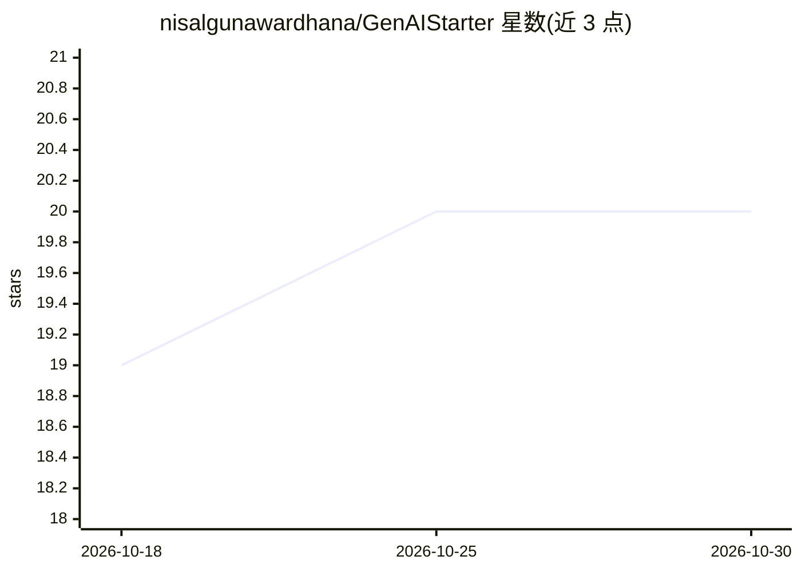

# nisalgunawardhana/GenAIStarter

⭐ 20 · C# · 推送 2025-11-27 · [GitHub](https://github.com/nisalgunawardhana/GenAIStarter) · [官网](https://nisalgunawardhana.com) · 个人维护

**.NET 生成式 AI 示例合集：演示接入 GitHub Models 与 Azure AI Foundry**

一组可独立运行的 .NET 9 控制台示例应用，通过 Azure.AI.Inference SDK 调用 GitHub Models 或 Azure AI Foundry 的模型端点。示例覆盖基础问答、多轮对话、编程助手、推理、图像分析（GPT-4o 视觉）与旅行支持 Agent 评估任务。README 提供从 fork、clone、dotnet restore/build 到 .env 配置（API_ENDPOINT/API_TOKEN）的完整步骤，以及 GitHub token 与 Azure Foundry 项目创建、凭证获取的图文指引。包含 MLSA 证书/徽章的评估提交流程。需 .NET 9 SDK 与模型访问凭证。

## 筛选速览

| 维度 | 判定 | 备注 |
|---|---|---|
| AI 角色 | `ai-knowledge` | 知识聚合/清单类 |
| 许可风险 | `none` | — |
| 部署形态 | `None` |  |
| 模型依赖 | — | README 未给出锁定关系 |
| 硬件要求 | — | 无带数字的原话,不猜 |
| 安装摩擦 | `medium` | 含编译或系统依赖之一 |
| 成熟度 | — | 结构信号不足 |

## 能力要点

- 6 个可独立 dotnet run 运行的示例（问答/多轮/编码助手/推理/图像分析/旅行 Agent）
- 通过 Azure.AI.Inference SDK 接入 GitHub Models 或 Azure AI Foundry
- 完整的 token 获取与 Foundry 项目创建图文步骤指引
- 含旅行支持 Agent 评估任务，完成后可获 MLSA 证书与徽章

## 适用场景

- 学习 .NET 应用接入大模型 API 的基本模式
- 快速原型验证 GitHub Models 或 Azure AI Foundry 的推理能力
- 完成 MLSA 评估任务获取证书与徽章
- 基于示例改造为自己的 AI 应用起点

## 场景标签

`教程课程` · 领域:学习与行业

## 证据(README 行号)

> L3: A concise collection of runnable .NET sample apps that demonstrate practical integration with GitHub Models and Azur
> L128: ## Available Examples
> L130: Each example can be run independently with its own command:

## 星数曲线

2026-10-18 19 → 2026-10-30 20（+1）

---
*卡片 v1 · prompt 1.4 · 生成 2026-10-28 · 置信度 high · 依据 README sha `2f8afc7f282f` · [字段定义](../../DATASET.md)*
