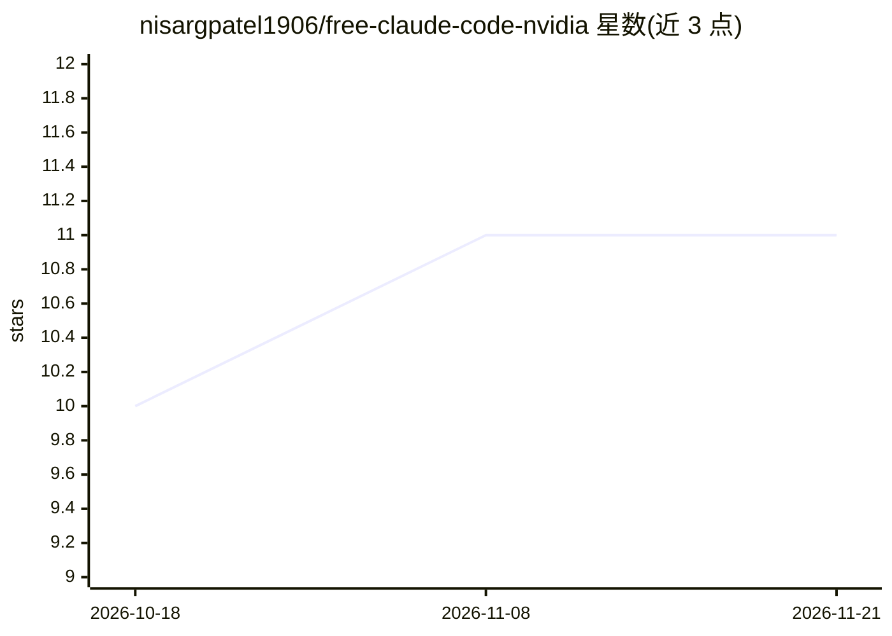

# nisargpatel1906/free-claude-code-nvidia

⭐ 11 · 推送 2026-06-22 · [GitHub](https://github.com/nisargpatel1906/free-claude-code-nvidia) · 个人维护

**免费通过 NVIDIA NIM 运行 Claude Code 的配置指南**

一份配置教程：通过本地 LiteLLM 代理（端口 4000）将 Claude Code 的 Anthropic 格式请求转换为 OpenAI 兼容格式，转发到 NVIDIA NIM 的免费 API 端点（integrate.api.nvidia.com）。内容覆盖获取免费 NVIDIA API key、安装 Node.js/Python/Claude Code/LiteLLM、编写 litellm_config.yaml 与 settings.json、后台启停代理脚本，以及 63 个 NIM 模型的切换命令目录。支持 Windows 与 macOS，无需 Anthropic 订阅。

## 筛选速览

| 维度 | 判定 | 备注 |
|---|---|---|
| AI 角色 | `ai-knowledge` | 知识聚合/清单类 |
| 许可风险 | `none` | — |
| 部署形态 | `desktop` | 安装包/桌面程序 |
| 模型依赖 | — | README 未给出锁定关系 |
| 硬件要求 | — | 无带数字的原话,不猜 |
| 安装摩擦 | `low` | 无编译、无系统依赖或容器化 |
| 成熟度 | — | 结构信号不足 |

## 能力要点

- LiteLLM 本地代理做 Anthropic→OpenAI 格式转换，接入 NVIDIA NIM 免费端点
- 提供 731 行完整 litellm_config.yaml 与 settings.json 可复制配置
- Windows VBS / macOS shell 的代理后台启停脚本
- 63 个 NIM 模型目录及 /model 会话内切换命令

## 适用场景

- 想用免费 NVIDIA NIM 模型驱动 Claude Code 编程助手
- 在没有 Anthropic 订阅的情况下配置 Claude Code
- 在多个 Llama/DeepSeek/Mistral 模型间切换编程助手后端

## 场景标签

`编码 Agent` `教程课程` · 领域:编码与开发

## 证据(README 行号)

> L17: # 🆓 Free Claude Code with NVIDIA NIM — Complete Setup Guide
> L24: Use **Claude Code** (Anthropic's official AI coding agent) **completely free** by routing it through **NVIDIA's fre
> L32: 2. **LiteLLM Proxy** runs locally on port `4000` as a translation layer. It intercepts Anthropic-formatted requests

## 星数曲线

2026-10-18 10 → 2026-11-21 11（+1）

---
*卡片 v1 · prompt 1.4 · 生成 2026-11-18 · 置信度 mid · 依据 README sha `1c5d4391a6e2` · [字段定义](../../DATASET.md)*
