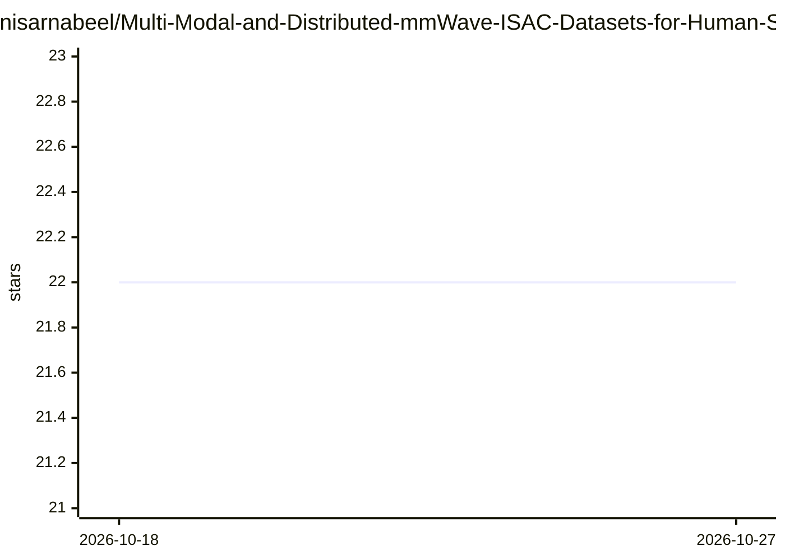

# nisarnabeel/Multi-Modal-and-Distributed-mmWave-ISAC-Datasets-for-Human-Sensing

⭐ 22 · Python · NOASSERTION · 推送 2026-05-19 · [GitHub](https://github.com/nisarnabeel/Multi-Modal-and-Distributed-mmWave-ISAC-Datasets-for-Human-Sensing) · 组织维护

**mmWave ISAC 人体感知数据集及 PyTorch 训练评测框架**

提供 6 个多模态分布式毫米波 ISAC 数据集（mmWGesture、5GmmGesture、mmWPose、DISAC-mmVRPose、mmW-Loc、mmW-GaitID），覆盖手势识别、姿态估计、定位与步态识别任务，数据经 IEEE DataPort 发布。配套即插即用的 PyTorch 训练评测代码：ResNet18 骨干、分类与回归两种任务、80/10/10 分层划分、可选背景减除。通过 pip 安装依赖、config.yaml 选择数据集后 python main.py 运行。CC BY 4.0 许可。

## 筛选速览

| 维度 | 判定 | 备注 |
|---|---|---|
| AI 角色 | `ai-native` | 本体是模型或模型工具 |
| 许可风险 | `none` | NOASSERTION |
| 部署形态 | `library` | 以包/库形式分发 |
| 模型依赖 | — | README 未给出锁定关系 |
| 硬件要求 | — | 无带数字的原话,不猜 |
| 安装摩擦 | `low` | 无编译、无系统依赖或容器化 |
| 成熟度 | — | 结构信号不足 |

## 能力要点

- 6 个 mmWave ISAC 数据集，覆盖分类与回归任务
- 通用 ResNet18 骨干开箱支持全部数据集
- 分层 80/10/10 划分与最优验证精度检查点
- 定位与步态数据集支持可选背景减除

## 适用场景

- 在 mmWave 数据上训练手势识别或姿态估计模型
- 做步态身份识别与毫米波定位研究
- 复现论文并与其他 ISAC 感知方法对比

## 场景标签

 · 领域:无线感知/深度学习

## 证据(README 行号)

> L5: A PyTorch framework for training and evaluating deep learning models on mmWave ISAC datasets, covering gesture recog
> L13: |Name|Task|Type|

## 星数曲线

2026-10-18 22 → 2026-10-27 22（+0）

---
*卡片 v1 · prompt 1.4 · 生成 2026-10-27 · 置信度 mid · 依据 README sha `adb832035278` · [字段定义](../../DATASET.md)*
