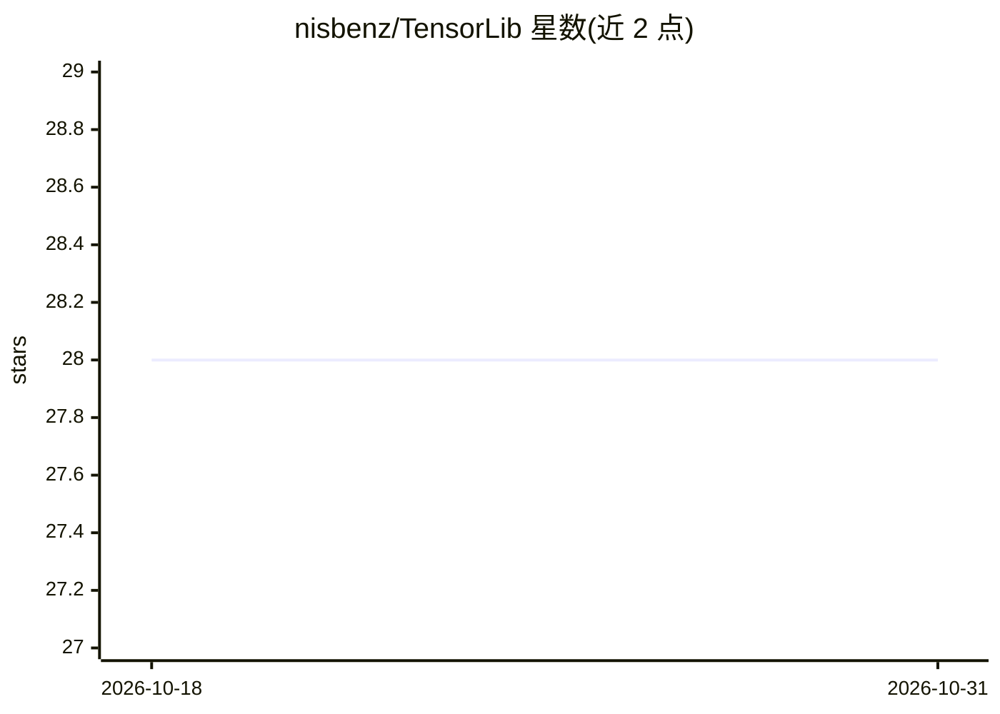

# nisbenz/TensorLib

⭐ 28 · C · MIT · 推送 2026-09-30 · [GitHub](https://github.com/nisbenz/TensorLib) · 个人维护

**纯 C 从零实现的 CPU 深度学习张量库，支持训练 Transformer**

用 C99 从零编写的张量与深度学习库，面向嵌入式等场景：提供 N 维张量（NumPy 式广播、零拷贝视图、引用计数存储）、动态反向自动微分引擎（24 个可算子）、Linear/LayerNorm/多头因果注意力/GPT 风格 Decoder 等模块、SGD/AdamW 优化器、原子化检查点与 AVX2+FMA SIMD 矩阵乘微内核。无外部 ML 依赖，仅 CPU，不用 Python/CUDA。附 tiny_lm 字节级语言模型与 MNIST 示例、33 个单元测试及基准套件；需 GCC/Clang 编译，在 Linux 与 Windows(MSYS2) 验证。

## 筛选速览

| 维度 | 判定 | 备注 |
|---|---|---|
| AI 角色 | `ai-ecosystem` | LLM/agent 周边工具 |
| 许可风险 | `permissive` | MIT |
| 部署形态 | `None` |  |
| 模型依赖 | — | README 未给出锁定关系 |
| 硬件要求 | `cpu-ok` | |
| 安装摩擦 | `high` | 编译与系统依赖俱全 |
| 成熟度 | — | 结构信号不足 |

## 能力要点

- 从零实现：零外部 ML 依赖，C99 仅 CPU
- 动态反向自动微分引擎（24 个可微算子）
- GPT-2 风格 Decoder 栈，附 tiny_lm 训练示例（约 190 万参数）
- AVX2+FMA 分块矩阵乘微内核（MR=4, NR=16）

## 适用场景

- 在 CPU 环境从源码训练小型语言模型或 MNIST 分类器
- 学习张量/autograd/Transformer 的从零实现
- 在嵌入式等资源受限场景使用 C 实现的深度学习库

## 场景标签

`模型训练` · 领域:训练与推理

## 证据(README 行号)

> L9:  A from-scratch deep learning tensor library written entirely in C
> L11:  N-dimensional tensors with autograd, Transformer building blocks, loss functions, optimizers, checkpointing, and S
> L238: |**No external ML deps**|Self-contained; every algorithm is implemented from scratch|

## 星数曲线

2026-10-18 28 → 2026-10-31 28（+0）

---
*卡片 v1 · prompt 1.4 · 生成 2026-10-26 · 置信度 high · 依据 README sha `965f9e782487` · [字段定义](../../DATASET.md)*
