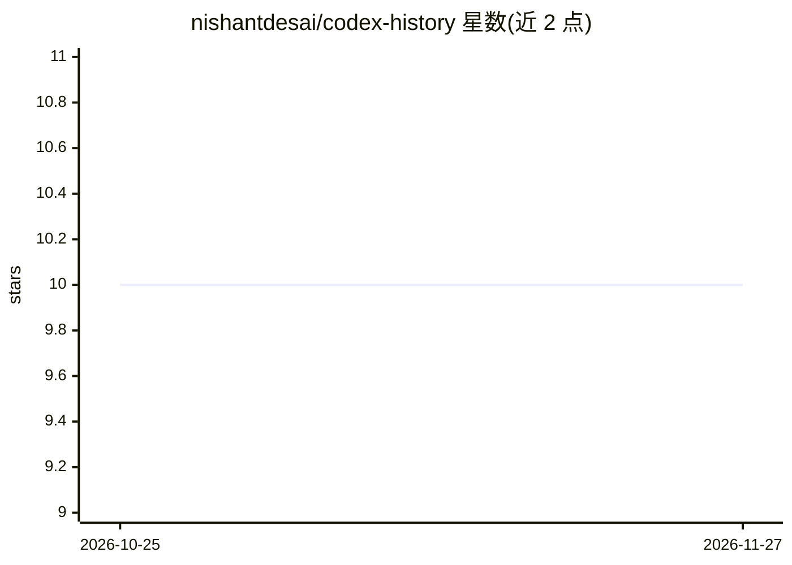

# nishantdesai/codex-history

⭐ 10 · Rust · MIT · 推送 2026-03-12 · [GitHub](https://github.com/nishantdesai/codex-history) · 个人维护

**本地 Codex 会话历史检索与导出的只读 CLI**

Rust 编写的命令行工具，读取本机 Codex CLI 的会话历史：提供索引化排序检索（search）与直接扫描（grep）两种模式，可查看线程、按 JSON/Markdown/prompt-pack 格式导出，并可选择性包含推理与工具调用内容。只读不改动、不上传历史，无遥测与后台进程，人类可读输出中保守脱敏密钥。通过 Homebrew tap 安装，也支持 cargo 源码构建；App Server 支持暂缓。

## 筛选速览

| 维度 | 判定 | 备注 |
|---|---|---|
| AI 角色 | `ai-ecosystem` | LLM/agent 周边工具 |
| 许可风险 | `permissive` | MIT |
| 部署形态 | `None` |  |
| 模型依赖 | — | README 未给出锁定关系 |
| 硬件要求 | — | 无带数字的原话,不猜 |
| 安装摩擦 | `medium` | 含编译或系统依赖之一 |
| 成熟度 | — | 结构信号不足 |

## 能力要点

- 索引检索与直接 grep 扫描两种搜索路径
- 导出为 JSON、Markdown 或 prompt-pack 交接格式
- 只读、无遥测，人类可读输出中脱敏密钥
- --include-thinking/--include-tools 控制搜索范围

## 适用场景

- 在历史 Codex 会话中检索之前讨论过的问题或报错
- 导出会话线程作为交接或归档材料
- 审计本地 Codex 使用记录而不改动原始数据

## 场景标签

 · 领域:开发者工具/AI CLI 会话管理

## 证据(README 行号)

> L3:  Read-only CLI for locally accessible Codex session history.
> L5:  Search transcripts, inspect threads, export handoffs, and build an optional local index.

## 星数曲线

2026-10-25 10 → 2026-11-27 10（+0）

---
*卡片 v1 · prompt 1.4 · 生成 2026-11-19 · 置信度 high · 依据 README sha `803a40171eb2` · [字段定义](../../DATASET.md)*
