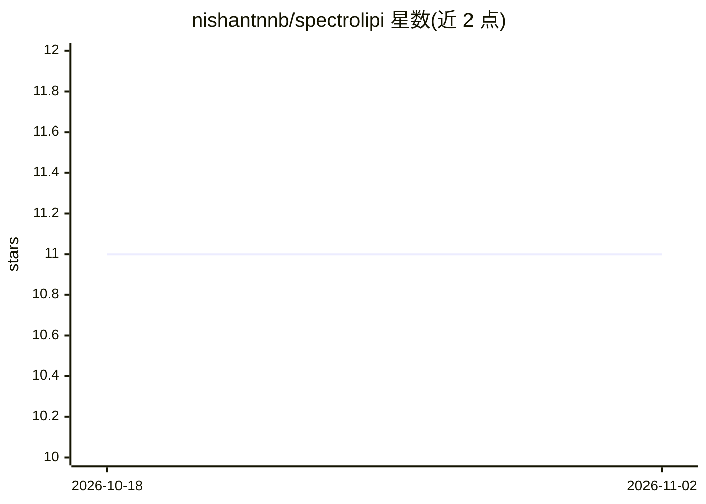

# nishantnnb/spectrolipi

⭐ 11 · JavaScript · GPL-3.0 · 推送 2026-10-01 · [GitHub](https://github.com/nishantnnb/spectrolipi) · [官网](https://spectrolipi.com) · 个人维护

**浏览器内生物声学频谱图标注与 BirdNET 辅助分析工具**

面向生物声学研究者、观鸟者与机器学习从业者的开源标注工具：在浏览器中可视化播放频谱图（可调色彩映射、增益、缩放），创建/编辑/导入/导出标注框，支持模板自动标注与重复模式快速标注，维护文件级元数据与物种列表（俗名/学名），并提供基础音频剪辑（裁切、静音、滤波、归一化）。可按标注导出音频片段并自动按物种分文件夹，用于训练声音识别模型；可集成 Xeno-canto 上传标注，并内置 BirdNET V2.4 辅助分析。除 BirdNET 模型下载外全部本地处理，无需安装。

## 筛选速览

| 维度 | 判定 | 备注 |
|---|---|---|
| AI 角色 | `ai-enhanced` | 去掉 AI 部分产品仍成立 |
| 许可风险 | `viral` | GPL-3.0 |
| 部署形态 | `None` |  |
| 模型依赖 | — | README 未给出锁定关系 |
| 硬件要求 | — | 无带数字的原话,不猜 |
| 安装摩擦 | `low` | 无编译、无系统依赖或容器化 |
| 成熟度 | — | 结构信号不足 |

## 能力要点

- 频谱图可视化播放（Colourmap/Gain/Zoom）与标注框管理
- 模板与 Repeat annotation 辅助标注重复声音模式
- 按标注导出音频片段并自动按物种文件夹分拣
- Xeno-canto 集成（JSON 上传或 API 直传）与 BirdNET V2.4 分析

## 适用场景

- 为声音识别模型制作物种标注训练数据
- 批量标注鸟类录音中的重复叫声模式
- 将标注成果上传至 Xeno-canto 共享

## 场景标签

`图像视频处理` · 领域:感知与多模态

## 证据(README 行号)

> L7: Bioacoustics researchers, birders, and machine‑learning practitioners often need a tool to visualize and annotate sp
> L21:  No data privacy concerns: All processing happens locally in your browser (except Birdnet model downloading). No ot
> L22:  Analyze and create annotations with Birdnet V2.4

## 星数曲线

2026-10-18 11 → 2026-11-02 11（+0）

---
*卡片 v1 · prompt 1.4 · 生成 2026-11-01 · 置信度 high · 依据 README sha `7b851d334781` · [字段定义](../../DATASET.md)*
