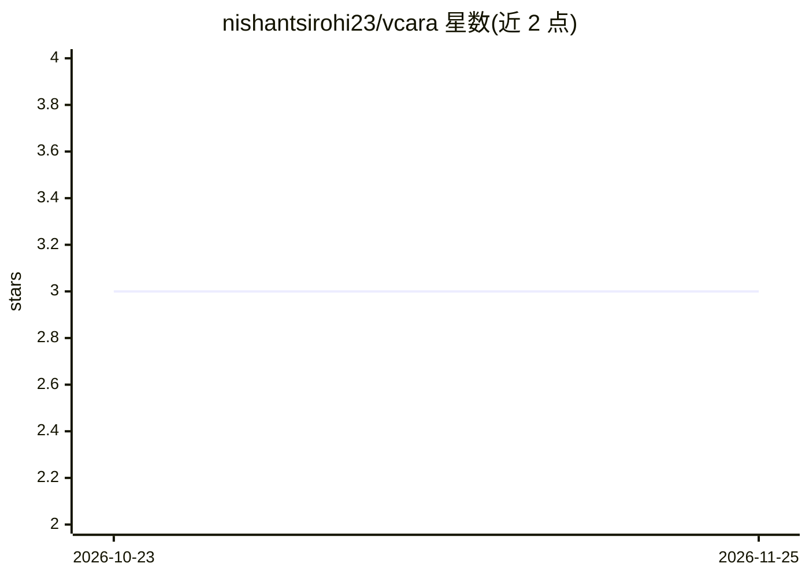

# nishantsirohi23/vcara

⭐ 3 · Python · MIT · 推送 2026-10-10 · [GitHub](https://github.com/nishantsirohi23/vcara) · [官网](https://huggingface.co/nishantsirohi2307/V-CARA) · 个人维护

**视觉强化学习算法 V-CARA 的研究实现与实验资源库**

V-CARA 是基于 Soft Actor-Critic 的视觉强化学习智能体，面向 CarRacing-v3 连续控制任务（64×64 灰度帧、4 帧堆叠）。仓库提供算法源码、训练/录像脚本、运行配置、多种子评估摘要、消融变体、单元测试、分析笔记本、评估视频及论文手稿与 LaTeX 源。实验局限在 README 中明示：no-CF 消融仅单种子、无配对检验，逐回合原始评估文件尚未包含。

## 筛选速览

| 维度 | 判定 | 备注 |
|---|---|---|
| AI 角色 | `ai-native` | 本体是模型或模型工具 |
| 许可风险 | `permissive` | MIT |
| 部署形态 | `library` | 以包/库形式分发 |
| 模型依赖 | — | README 未给出锁定关系 |
| 硬件要求 | — | 无带数字的原话,不猜 |
| 安装摩擦 | `medium` | 含编译或系统依赖之一 |
| 成熟度 | — | 结构信号不足 |

## 能力要点

- SAC 之上加入不确定性门控局部反事实动作评估、潜在转移集成与覆盖率感知回放
- 4 个独立训练种子、checkpoint 覆盖 100k–1M 帧，含 9 种消融变体
- 提供训练、录像、图表再生成脚本与笔记本，附 CI（测试与 lint）
- 包含论文手稿 PDF 与 LaTeX 源及 CITATION.cff

## 适用场景

- 复现 CarRacing-v3 上的视觉连续控制训练实验
- 运行多种子与消融变体对比评估
- 录制已训练策略的评估视频用于分析

## 场景标签

`强化学习` · 领域:训练与推理

## 证据(README 行号)

> L3: Code, configurations, evaluation summaries, and videos for **V-CARA**, a visual reinforcement-learning agent built o
> L5: V-CARA adds to SAC: a latent transition ensemble, uncertainty-gated local counterfactual action evaluation, risk and

## 星数曲线

2026-10-23 3 → 2026-11-25 3（+0）

---
*卡片 v1 · prompt 1.4 · 生成 2026-11-21 · 置信度 high · 依据 README sha `c245c1010c8a` · [字段定义](../../DATASET.md)*
