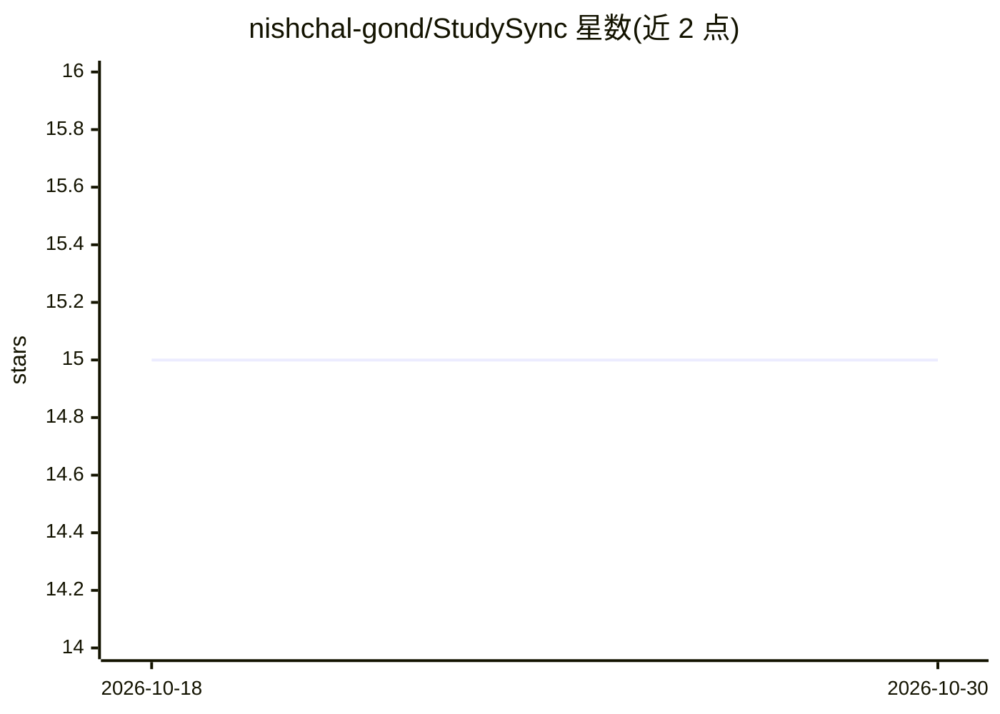

# nishchal-gond/StudySync

⭐ 15 · Jupyter Notebook · MIT · 推送 2026-09-02 · [GitHub](https://github.com/nishchal-gond/StudySync) · 个人维护

**帮学生比对笔记与课程大纲、找出知识缺口的学习工具**

面向学生的 Web 应用：上传文档、PDF、PPT 或手写笔记照片，使用 GPT-4 API 提取文本并识别已覆盖主题，与课程大纲比对后标出知识缺口，并生成针对性测验与随测验表现动态更新的闪卡，同时给出补充学习资源。前端采用 React 与 TailwindCSS，后端为 Node.js/Express，另使用 Firebase 提供后端服务。运行需自备 OpenAI API key，前后端分别通过 npm 安装依赖并启动，仓库描述另提及糖尿病预测 notebook 的示例内容。限制：需自行配置 API key 并分别启动两个服务。

## 筛选速览

| 维度 | 判定 | 备注 |
|---|---|---|
| AI 角色 | `ai-native` | 本体是模型或模型工具 |
| 许可风险 | `permissive` | MIT |
| 部署形态 | `library` | 以包/库形式分发 |
| 模型依赖 | — | README 未给出锁定关系 |
| 硬件要求 | — | 无带数字的原话,不猜 |
| 安装摩擦 | `low` | 无编译、无系统依赖或容器化 |
| 成熟度 | — | 结构信号不足 |

## 能力要点

- 支持文档/PDF/PPT/手写笔记照片多格式上传
- 使用 GPT-4 API 进行文本提取与主题识别
- 笔记主题与课程大纲的缺口分析
- AI 生成测验与按表现动态更新的闪卡

## 适用场景

- 考试前检查笔记是否完整覆盖课程内容
- 针对薄弱主题生成练习测验和闪卡
- 获取填补知识缺口的学习资源推荐

## 场景标签

`文档解析` · 领域:知识与检索

## 证据(README 行号)

> L21: StudySync is an innovative solution designed to help students ensure their study materials comprehensively cover th
> L25: - AI-powered text extraction and topic identification using GPT-4 API.

## 星数曲线

2026-10-18 15 → 2026-10-30 15（+0）

---
*卡片 v1 · prompt 1.4 · 生成 2026-10-30 · 置信度 high · 依据 README sha `f68f30edb2f8` · [字段定义](../../DATASET.md)*
