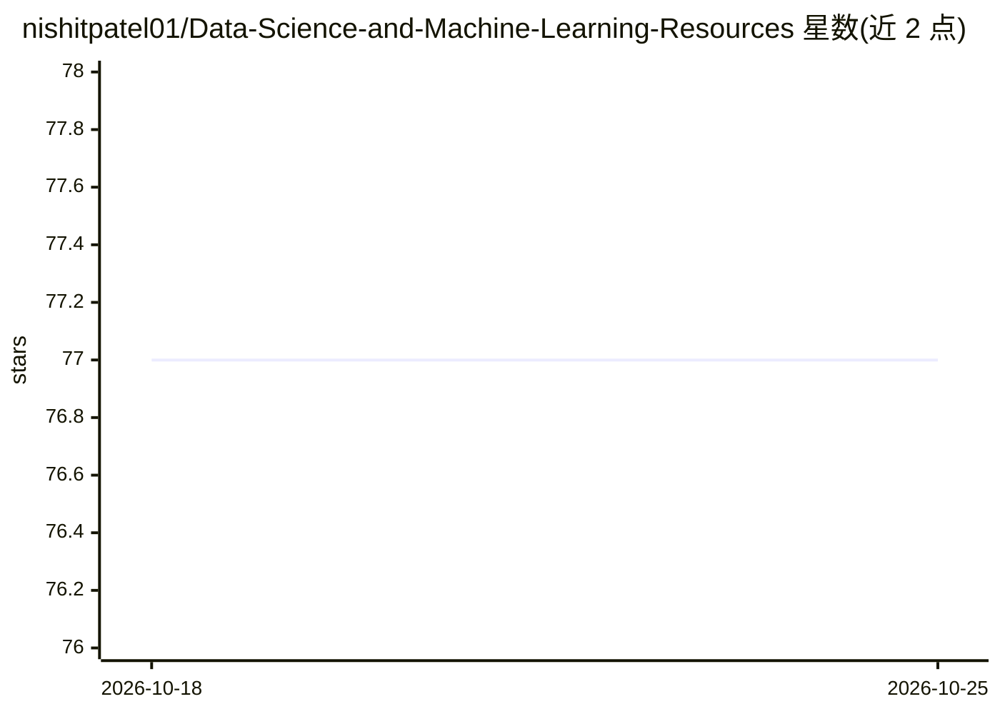

# nishitpatel01/Data-Science-and-Machine-Learning-Resources

⭐ 77 · MIT · 推送 2026-10-11 · [GitHub](https://github.com/nishitpatel01/Data-Science-and-Machine-Learning-Resources) · 个人维护

**个人维护的数据科学与机器学习学习资源链接清单**

作者个人常用的数据科学与机器学习资源聚合清单：按 Agentic AI、LLM 与生成式 AI、数据科学、R、Python、机器学习、MLOps、统计、深度学习、时间序列、NLP、大数据、公共数据集、免费电子书、面试准备、播客等约 30 个类别组织，收录博客、论文、课程、数据集、教程与视频链接。内容为纯链接列表，无可安装代码，不涉及运行机制。适合学习者与求职者按主题查找资料。

## 筛选速览

| 维度 | 判定 | 备注 |
|---|---|---|
| AI 角色 | `ai-knowledge` | 知识聚合/清单类 |
| 许可风险 | `permissive` | MIT |
| 部署形态 | `None` |  |
| 模型依赖 | — | README 未给出锁定关系 |
| 硬件要求 | — | 无带数字的原话,不猜 |
| 安装摩擦 | `low` | 无编译、无系统依赖或容器化 |
| 成熟度 | — | 结构信号不足 |

## 能力要点

- 约 30 个主题分类，覆盖 LLM、ML、MLOps、统计、大数据等
- 收录 LLM 研究论文与公共数据集链接
- 包含数据科学/AI 工程师面试准备与播客资源

## 适用场景

- 按主题查找数据科学和机器学习学习资料
- 准备数据科学或 AI 工程师面试
- 查找公共数据集和免费电子书

## 场景标签

`精选清单` · 领域:学习与行业

## 证据(README 行号)

> L1: # Awesome Data-Science-and-Machine-Learning-Resources
> L2: List of Data Science and Machine Learning Resource that I frequently use

## 星数曲线

2026-10-18 77 → 2026-10-25 77（+0）

---
*卡片 v1 · prompt 1.4 · 生成 2026-10-24 · 置信度 high · 依据 README sha `c2b31921a144` · [字段定义](../../DATASET.md)*
