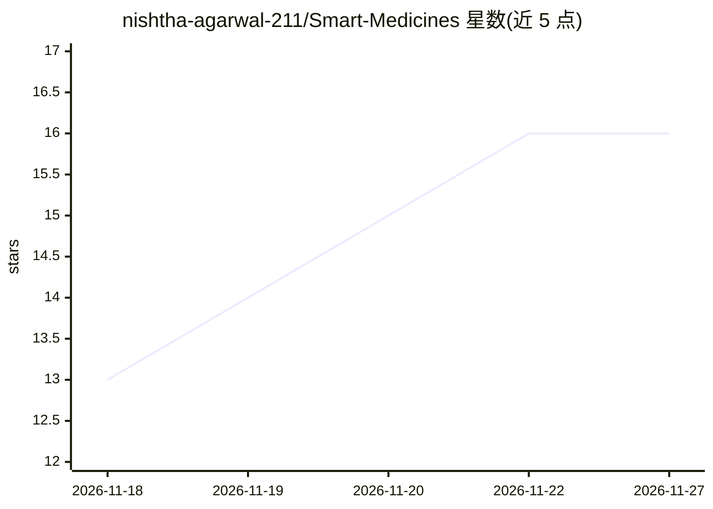

# nishtha-agarwal-211/Smart-Medicines

⭐ 16 · JavaScript · 推送 2026-07-25 · [GitHub](https://github.com/nishtha-agarwal-211/Smart-Medicines) · 个人维护

**面向老年患者的 AI 用药管理助手：处方扫描、相互作用检测与提醒**

基于 React + Google Gemini + Firebase 的个人项目，将用药管理做成可对话的应用：上传处方照片由 Gemini Vision 提取药名/剂量/频次/警告，扫描当前药物的相互作用并分级，漏服时给出服用/跳过/就医建议，另含 7 天依从性图表、补药提醒、紧急卡片与 PDF 导出。数据默认存 Firebase Firestore，未配置 Firebase 时回退到 localStorage 与本地认证，全部功能仍可运行。

## 筛选速览

| 维度 | 判定 | 备注 |
|---|---|---|
| AI 角色 | `ai-native` | 本体是模型或模型工具 |
| 许可风险 | `none` | — |
| 部署形态 | `None` |  |
| 模型依赖 | — | README 未给出锁定关系 |
| 硬件要求 | — | 无带数字的原话,不猜 |
| 安装摩擦 | `low` | 无编译、无系统依赖或容器化 |
| 成熟度 | — | 结构信号不足 |

## 能力要点

- Gemini Vision 处方扫描提取药名、剂量、频次与警告
- 药物相互作用检测并按高/中/低严重度分级
- 漏服顾问：AI 依据药名、时间与半衰期给出建议
- 无 Firebase 时回退 localStorage，功能保持一致

## 适用场景

- 用手机拍处方照片自动录入用药计划
- 询问新药与当前药物是否可以同服
- 为家人管理漏服提醒并导出紧急信息卡

## 场景标签

`文档解析` · 领域:知识与检索

## 证据(README 行号)

> L18: |**📸 Prescription Scanner**|Upload a photo → Gemini Vision extracts drug name, dosage, frequency, warnings|
> L140: 3. Gemini reasons over the drug name, timing, and half-life
> L165: > ⚠️ **Note:** For a production healthcare app, you would need Firestore security rules, end-to-end encryption, an

## 星数曲线

2026-11-18 13 → 2026-11-27 16（+3）

---
*卡片 v1 · prompt 1.4 · 生成 2026-11-18 · 置信度 high · 依据 README sha `6618f997412d` · [字段定义](../../DATASET.md)*
