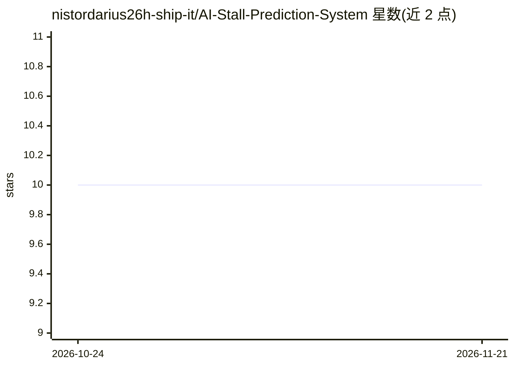

# nistordarius26h-ship-it/AI-Stall-Prediction-System

⭐ 10 · Python · MIT · 推送 2026-07-18 · [GitHub](https://github.com/nistordarius26h-ship-it/AI-Stall-Prediction-System) · 个人维护

**面向航空研究者的前视 LiDAR 失速裕度预测研究原型**

一个面向教学与研究用途的飞机失速裕度预测研究原型：结合前视 LiDAR、常规机载传感器与机器学习，提前探测气流扰动并估算剩余失速裕度，包含传感器融合、有效迎角估计与驾驶舱告警显示设计。系统架构基于 ESP32 数据采集与 NVIDIA Jetson 运行推理，通过 Python、Scikit-Learn、TensorFlow、Streamlit 实现，并与 FlightGear、X-Plane 飞行模拟器集成。README 明确声明未获认证，不得用于真实飞行决策；仓库含完整论文 PDF，安装运行步骤未给出。

## 筛选速览

| 维度 | 判定 | 备注 |
|---|---|---|
| AI 角色 | `ai-native` | 本体是模型或模型工具 |
| 许可风险 | `permissive` | MIT |
| 部署形态 | `None` |  |
| 模型依赖 | — | README 未给出锁定关系 |
| 硬件要求 | — | 无带数字的原话,不猜 |
| 安装摩擦 | `low` | 无编译、无系统依赖或容器化 |
| 成熟度 | — | 结构信号不足 |

## 能力要点

- 前视 LiDAR + 传感器融合 + 机器学习的失速裕度预测流程
- 有效迎角估计与失速裕度计算（含示例代码）
- 与 FlightGear、X-Plane 飞行模拟器集成
- 含完整研究论文 PDF 与架构图

## 适用场景

- 研究湍流条件下失速风险的提前预测
- 搭建飞行模拟器中的传感器融合实验
- 教学场景演示 AI 在航空安全中的应用

## 场景标签

`科研工具` · 领域:学习与行业

## 证据(README 行号)

> L10: This project presents a research prototype for an **AI-powered aircraft stall margin prediction system** that combi
> L22: - Machine learning prediction
> L38: -- Machine Learning

## 星数曲线

2026-10-24 10 → 2026-11-21 10（+0）

---
*卡片 v1 · prompt 1.4 · 生成 2026-11-19 · 置信度 high · 依据 README sha `ae0768b214c0` · [字段定义](../../DATASET.md)*
