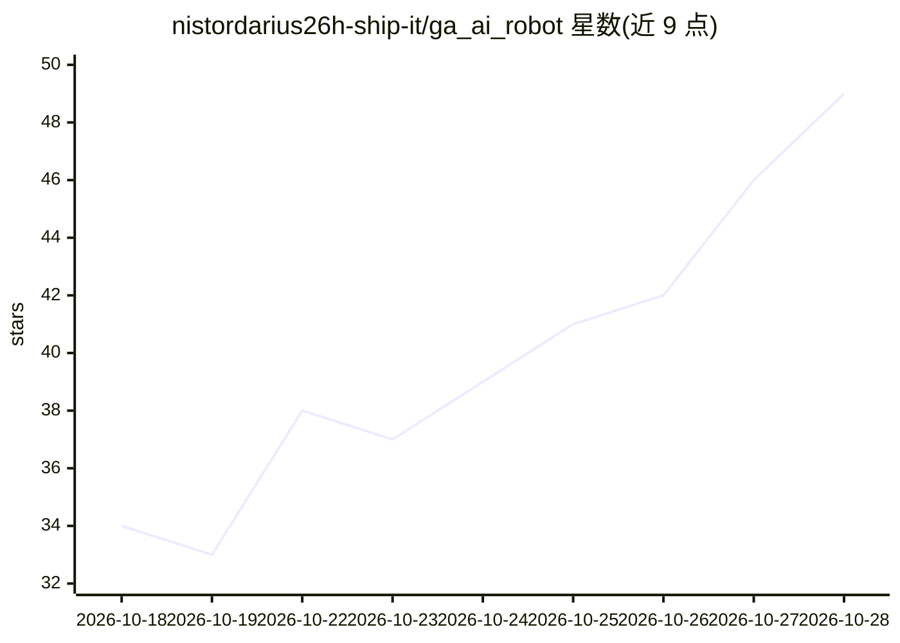

# nistordarius26h-ship-it/ga_ai_robot

⭐ 49 · Python · NOASSERTION · 推送 2026-09-15 · [GitHub](https://github.com/nistordarius26h-ship-it/ga_ai_robot) · [官网](nddev.dpdns.org) · 个人维护

**个人全地形自主机器人：4G 远程控制与 AI 目标跟踪**

四轮差速驱动机器人工程：ESP32 作电机/传感器控制器并实现看门狗、心跳、超声刹车等本地失效保护；Raspberry Pi 4 运行 Flask 仪表盘、串口桥、MediaMTX WebRTC 视频与 Cloudflare Quick Tunnel，通过 Telegram 推送动态 URL 实现 4G 远程访问。感知采用板外 GPU 工作站的 YOLO11 + ByteTrack，跟踪实现维护在独立仓库。README 声明为个人工程而非认证产品，高压接线需自行核验；仓库许可为 portfolio/仅浏览用途，非 MIT。

## 筛选速览

| 维度 | 判定 | 备注 |
|---|---|---|
| AI 角色 | `ai-enhanced` | 去掉 AI 部分产品仍成立 |
| 许可风险 | `none` | NOASSERTION |
| 部署形态 | `None` |  |
| 模型依赖 | — | README 未给出锁定关系 |
| 硬件要求 | — | 无带数字的原话,不猜 |
| 安装摩擦 | `low` | 无编译、无系统依赖或容器化 |
| 成熟度 | `idea` | |

## 能力要点

- ESP32 固件含串口看门狗、Pi 心跳、PCA9685 OE 硬件禁用与超声前撞刹车等安全机制
- Cloudflare Quick Tunnel + MediaMTX WebRTC/WHEP 实现 4G 远程视频与仪表盘
- YOLO11 + ByteTrack 板外推理用于检测/跟踪与跟随实验
- 文档涵盖 ESP32 引脚映射、电机通道表、PCB v1 规划与导航扩展路线

## 适用场景

- 通过 4G 网络在全球范围远程驾驶和查看机器人视频
- 进行目标检测跟踪与人员跟随的机器人实验
- 参考其 ESP32 安全固件与差速转向模式设计

## 场景标签

`目标检测` · 领域:感知与多模态

## 证据(README 行号)

> L3: Four-wheel differential-drive robot built around an ESP32 real-time controller, Raspberry Pi 4 edge computer, 4G/LTE
> L154: The robot integration uses YOLO11 + ByteTrack for detection/tracking and person-following experiments. Heavy infer

## 星数曲线

2026-10-18 34 → 2026-10-28 49（+15）

---
*卡片 v1 · prompt 1.4 · 生成 2026-10-25 · 置信度 high · 依据 README sha `2eae6baec9a2` · [字段定义](../../DATASET.md)*
