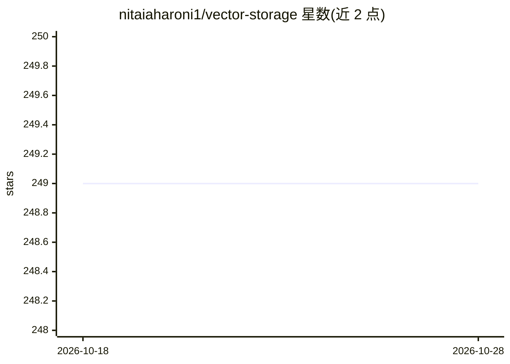

# nitaiaharoni1/vector-storage

⭐ 249 · TypeScript · MIT · 推送 2026-08-12 · [GitHub](https://github.com/nitaiaharoni1/vector-storage) · [官网](https://www.npmjs.com/package/vector-storage) · 个人维护

**浏览器 IndexedDB 向量库：为前端提供文本语义相似检索**

TypeScript/npm 包，在浏览器 IndexedDB 中存储文档向量，支持基于余弦相似度的语义检索。调用 OpenAI embeddings API 将文本转为向量（需提供 API key，默认模型 text-embedding-ada-002），提供 addText/addTexts 与 similaritySearch 接口，可按 metadata 或文本内容过滤结果。内建 LRU 机制：存储超限时按命中次数与时间戳升序移除文档。默认上限 2GB，保存可设置防抖。面向需要在客户端本地实现语义搜索的前端开发者。

## 筛选速览

| 维度 | 判定 | 备注 |
|---|---|---|
| AI 角色 | `ai-ecosystem` | LLM/agent 周边工具 |
| 许可风险 | `permissive` | MIT |
| 部署形态 | `library` | 以包/库形式分发 |
| 模型依赖 | — | README 未给出锁定关系 |
| 硬件要求 | — | 无带数字的原话,不猜 |
| 安装摩擦 | `low` | 无编译、无系统依赖或容器化 |
| 成熟度 | — | 结构信号不足 |

## 能力要点

- 文档向量存储于浏览器 IndexedDB
- OpenAI embeddings 生成向量，余弦相似度检索
- 检索结果支持按 metadata 或文本内容过滤
- LRU 机制自动清理超限文档（默认上限 2GB）

## 适用场景

- 在浏览器端为站点文档做本地语义搜索
- 为 Web 应用添加无需后端的相似内容检索
- 客户端向量存储并在容量超限时自动淘汰旧文档

## 场景标签

`向量数据库` `语义搜索` · 领域:知识与检索

## 证据(README 行号)

> L3: Vector Storage is a lightweight and efficient vector database that stores document vectors in the browser's IndexedD
> L58:   openAIApiKey: string; // The OpenAI API key used for generating embeddings.

## 星数曲线

2026-10-18 249 → 2026-10-28 249（+0）

---
*卡片 v1 · prompt 1.4 · 生成 2026-10-22 · 置信度 high · 依据 README sha `34508eb4856e` · [字段定义](../../DATASET.md)*
