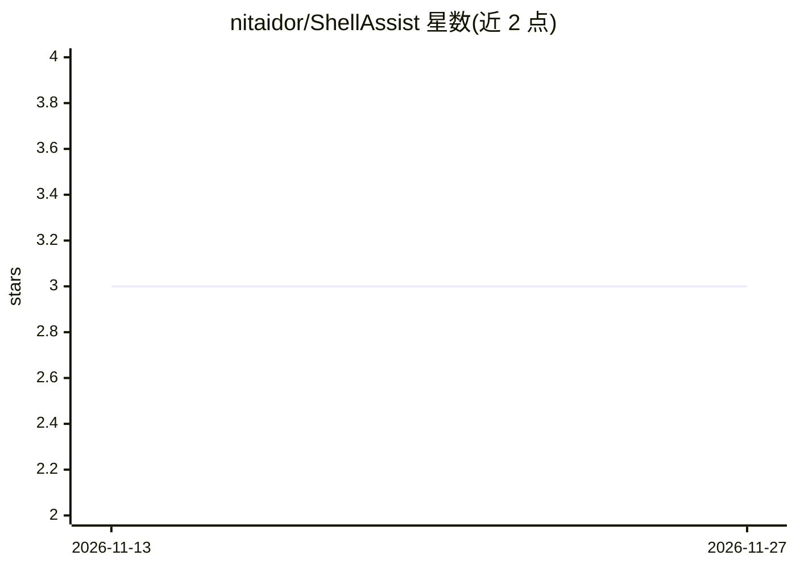

# nitaidor/ShellAssist

⭐ 3 · JavaScript · MIT · 推送 2026-11-20 · [GitHub](https://github.com/nitaidor/ShellAssist) · 个人维护

**跨平台桌面助手：用 AI 构建、调试、模拟执行 shell 命令**

面向终端用户的 Electron 桌面应用，覆盖 shell 命令的生成、分析、调试与执行流程：英文描述转命令生成、AI 沙箱模拟终端测试命令、本地实时执行与自动调试循环、token 检查与风险评估。通过自带 API key 接入云端模型，或经本地 Ollama 离线运行；另有浏览器版，但实时执行与本地 Ollama 仅桌面版支持。安装方式为下载 Release 可执行文件或源码构建（需 Node.js）。

## 筛选速览

| 维度 | 判定 | 备注 |
|---|---|---|
| AI 角色 | `ai-native` | 本体是模型或模型工具 |
| 许可风险 | `permissive` | MIT |
| 部署形态 | `desktop` | 安装包/桌面程序 |
| 模型依赖 | local-ok | 支持本地模型 |
| 硬件要求 | — | 无带数字的原话,不猜 |
| 安装摩擦 | `low` | 无编译、无系统依赖或容器化 |
| 成熟度 | — | 结构信号不足 |

## 能力要点

- 英文到 shell 命令的生成与迭代精修
- AI 沙箱模拟终端，命令上真机前先行测试
- 本地实时执行与自动调试循环、风险评估
- 支持 Gemini/ChatGPT/Claude API 或本地 Ollama 离线运行

## 适用场景

- 在不熟悉命令行语法的情况下生成 shell 命令
- 测试从网上复制的复杂脚本，避免直接在真实系统上执行
- 离线私密环境下用本地模型生成和调试命令

## 场景标签

`AI 助手` `代码生成` · 领域:编码与开发

## 证据(README 行号)

> L3: An AI-powered desktop assistant to build, analyze, debug, simulate, and execute shell commands across Windows, macOS
> L14: * **Multi-AI Engine:** Bring your own API key (Gemini, ChatGPT, Claude) or run 100% privately via local Ollama.

## 星数曲线

2026-11-13 3 → 2026-11-27 3（+0）

---
*卡片 v1 · prompt 1.4 · 生成 2026-11-21 · 置信度 high · 依据 README sha `5c1769e4ca6e` · [字段定义](../../DATASET.md)*
