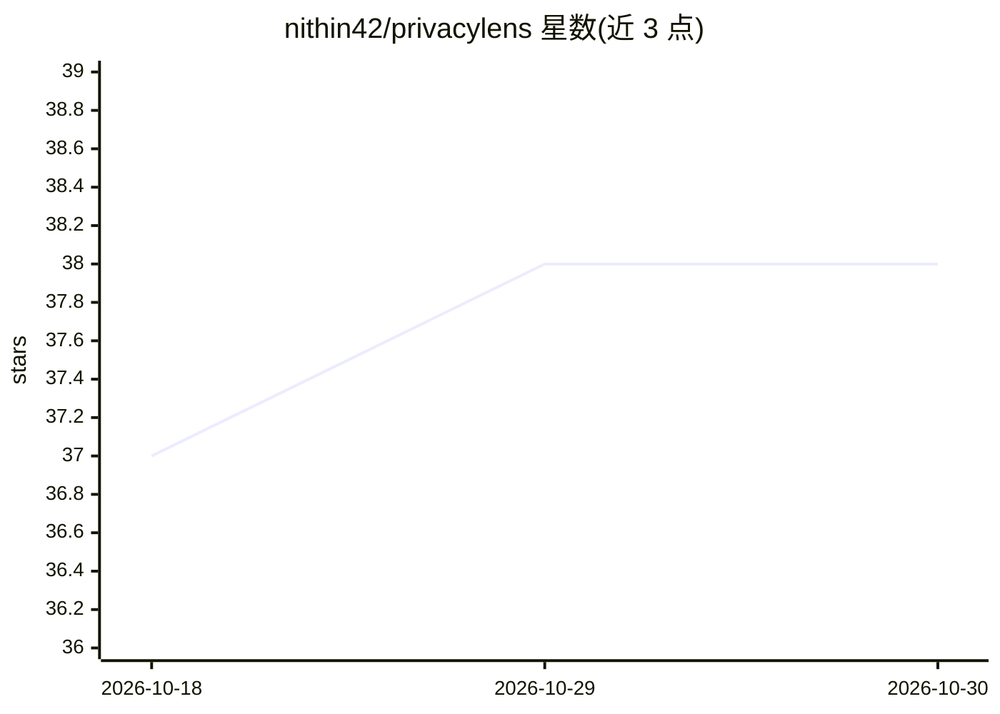

# nithin42/privacylens

⭐ 38 · Python · MIT · 推送 2026-09-30 · [GitHub](https://github.com/nithin42/privacylens) · 个人维护

**面向开发者的 ML 模型隐私漏洞审计库：检测训练数据泄露风险**

开源 Python 隐私审计工具包，对任意 ML 模型（scikit-learn、PyTorch、XGBoost、HuggingFace Transformers）运行 5 项自动检查：成员推断攻击（MIA）、PII 泄露检测、模型反演风险评分、属性推断攻击、差分隐私 ε 估计。面向在 CI/CD 中拦截隐私缺陷的开发者，以及需要 GDPR/HIPAA 合规报告的企业。提供 CLI 与 Python API，可输出交互式 HTML 合规报告与 JSON 结果；含 Azure ML Pipeline 隐私门禁步骤与 Azure OpenAI 微调部署审计器。PyPI 包名为 privacyaudit。

## 筛选速览

| 维度 | 判定 | 备注 |
|---|---|---|
| AI 角色 | `ai-ecosystem` | LLM/agent 周边工具 |
| 许可风险 | `permissive` | MIT |
| 部署形态 | `library` | 以包/库形式分发 |
| 模型依赖 | locked-api |  |
| 硬件要求 | — | 无带数字的原话,不猜 |
| 安装摩擦 | `low` | 无编译、无系统依赖或容器化 |
| 成熟度 | — | 结构信号不足 |

## 能力要点

- 5 项隐私攻击检查（MIA/PII 泄露/模型反演/属性推断/差分隐私 ε 估计）
- 原生支持 scikit-learn、PyTorch、XGBoost、HuggingFace Transformers
- Azure ML Pipeline 隐私门禁步骤与 Azure OpenAI 部署审计器
- HTML 合规报告与 JSON 输出，可集成 CI/CD

## 适用场景

- 模型上线前在 CI/CD 中自动检测训练数据泄露风险
- 生成 GDPR/HIPAA 合规用的 HTML 审计报告
- 审计 Azure OpenAI 微调部署的 PII 记忆泄露

## 场景标签

`网络安全` · 领域:学习与行业

## 证据(README 行号)

> L21: > **The Solution**: `privacylens` is an open-source privacy auditing toolkit. In **3 lines of code**, it runs **5 a
> L47: - 🕵️ **1. Membership Inference Attack (MIA)** — Detect if an attacker can identify training records using shadow mo
> L56: - 🤖 **CLI + Python API** — Use in scripts or integrate into CI/CD pipelines (`privacylens audit`)

## 星数曲线

2026-10-18 37 → 2026-10-30 38（+1）

---
*卡片 v1 · prompt 1.4 · 生成 2026-10-25 · 置信度 high · 依据 README sha `16fb973eeccc` · [字段定义](../../DATASET.md)*
