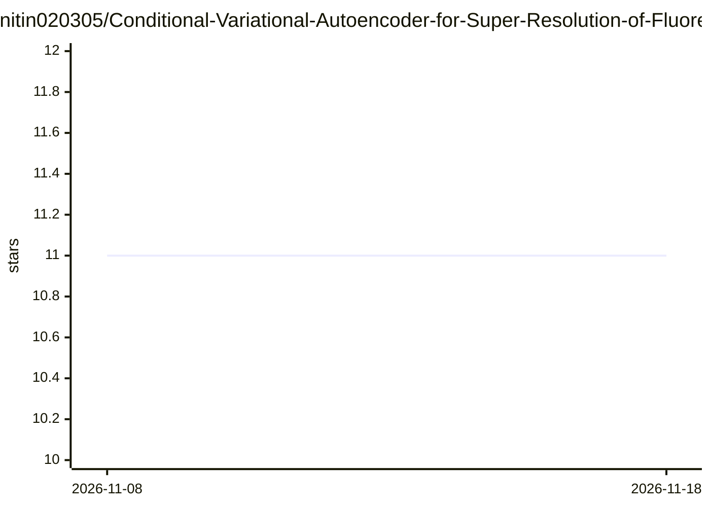

# nitin020305/Conditional-Variational-Autoencoder-for-Super-Resolution-of-Fluorescence-Microscopy-

⭐ 11 · Jupyter Notebook · 推送 2026-11-03 · [GitHub](https://github.com/nitin020305/Conditional-Variational-Autoencoder-for-Super-Resolution-of-Fluorescence-Microscopy-) · 个人维护

**宽场荧光显微图像 2× 超分辨的条件变分自编码器实现**

基于 PyTorch 的 SR-VAE 模型实现，从宽场荧光显微图像重建 2× 超分辨图像。在 BioSR CCPs 子集（20,250 对训练数据）上以 SIM 图像为高分辨率目标训练，遵循 Liu, Siu and Chan (IEEE TCSVT, 2021) 方法并适配单通道显微数据。推理时跳过编码器，由输入条件采样器 G(X) 生成隐变量。以两个 Jupyter notebook 提供训练与按信号水平的测试流程，推理可在 CPU 运行。

## 筛选速览

| 维度 | 判定 | 备注 |
|---|---|---|
| AI 角色 | `ai-native` | 本体是模型或模型工具 |
| 许可风险 | `none` | — |
| 部署形态 | `library` | 以包/库形式分发 |
| 模型依赖 | — | README 未给出锁定关系 |
| 硬件要求 | `gpu-8g` | |
| 安装摩擦 | `medium` | 含编译或系统依赖之一 |
| 成熟度 | — | 结构信号不足 |

## 能力要点

- 推理时丢弃编码器，用输入条件采样器 G(X) 替代标准正态噪声
- 测试集 135 张图像（9 个信号水平）报告 PSNR/SSIM 并与 bicubic 插值对比
- 分块推理（64×64 LR 切片、8 像素重叠）并丢弃切边伪影
- 以 Jupyter notebook 形式提供完整训练与测试流程

## 适用场景

- 将宽场荧光显微图像重建为 2× 超分辨图像
- 在 BioSR CCPs 数据集上复现训练与评估
- 按信号水平批量测试并导出超分辨 TIFF 结果

## 场景标签

`图像视频处理` · 领域:感知与多模态

## 证据(README 行号)

> L3: We reconstruct 2× super-resolved fluorescence microscopy images from widefield inputs using a conditional variationa
> L166: You need Python 3.10 or newer and Jupyter. A CUDA GPU is strongly recommended for training (CPU is fine for testin
> L238: 4. The training cell prints one line per epoch with loss terms, validation PSNR/SSIM and the bicubic reference. Ex

## 星数曲线

2026-11-08 11 → 2026-11-18 11（+0）

---
*卡片 v1 · prompt 1.4 · 生成 2026-11-18 · 置信度 high · 依据 README sha `9b054629dd67` · [字段定义](../../DATASET.md)*
