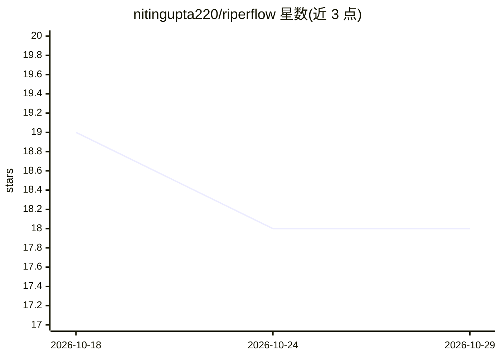

# nitingupta220/riperflow

⭐ 18 · TypeScript · MIT · 推送 2026-10-16 · [GitHub](https://github.com/nitingupta220/riperflow) · [官网](https://www.npmjs.com/package/riperflow) · 个人维护

**为 10 种 AI 编码工具统一生成一套工作流规范文件的 CLI**

以仓库内 memory-bank（六个 markdown 文件）为单一事实源，为 Cursor、Claude Code、Aider 等 10 种 AI 编码工具按各自原生格式生成规则文件，实现 RIPER 五模式（Research/Innovate/Plan/Execute/Review）权限约束，规格约 1,350 token。附带 BMAD 角色划分、五阶段质量门、六级代码保护与仅绑定 127.0.0.1 的本地实时仪表盘，并可为支持 MCP 的工具级联生成 MCP 配置。通过 npx 安装，需 Node 20+，端到端测试仅在 Linux 上完成。

## 筛选速览

| 维度 | 判定 | 备注 |
|---|---|---|
| AI 角色 | `ai-ecosystem` | LLM/agent 周边工具 |
| 许可风险 | `permissive` | MIT |
| 部署形态 | `library` | 以包/库形式分发 |
| 模型依赖 | — | README 未给出锁定关系 |
| 硬件要求 | — | 无带数字的原话,不猜 |
| 安装摩擦 | `low` | 无编译、无系统依赖或容器化 |
| 成熟度 | — | 结构信号不足 |

## 能力要点

- 一份 memory-bank 生成 10 种工具的原生规则文件
- RIPER 五模式权限由生成文件强制，AI 拒绝越模式编辑
- 规格平均约 1,350 token（14 个规则文件实测 518–1,763）
- MCP 配置一次添加、级联到各支持工具

## 适用场景

- 同时使用多个 AI 编码工具时维护一份项目规则
- 为 AI 编码助手设置模式与代码保护约束
- 团队内按角色与质量门阶段组织 AI 驱动开发

## 场景标签

`提示工程` · 领域:Agent 开发

## 证据(README 行号)

> L17: Riperflow keeps **one source of truth** (a small memory bank in your repo) and generates the right rule file for ea

## 星数曲线

2026-10-18 19 → 2026-10-29 18（-1）

---
*卡片 v1 · prompt 1.4 · 生成 2026-10-29 · 置信度 high · 依据 README sha `cd79171c6606` · [字段定义](../../DATASET.md)*
